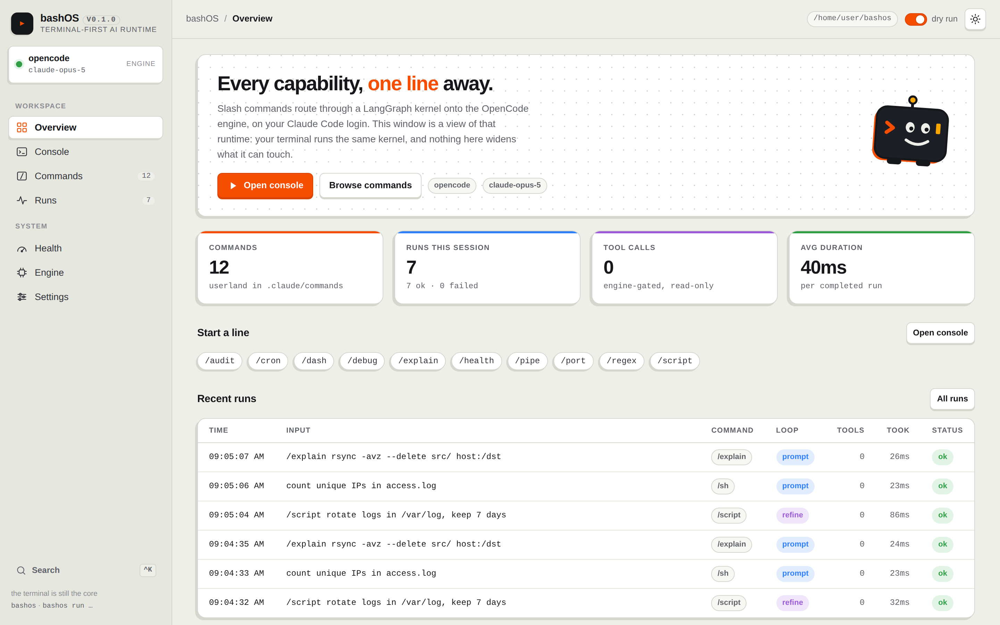

# bashOS

> Terminal-first AI runtime that routes Claude slash commands through a LangGraph kernel onto the OpenCode engine.

[](https://github.com/bamr87/bashos/actions/workflows/ci.yml) [](pyproject.toml) [](LICENSE)

## Overview

**A terminal-first AI runtime** on your Claude Code OAuth, for all things software development and information systems.

```
 _             _    ___  ____
| |__  __ _ __| |_ / _ \/ ___|
| '_ \/ _` (_-< ' \ (_) \___ \
|_.__/\__,_/__/_||_\___/|____/
```

The terminal is the core access point: a windowed **terminal desktop** (and a one-shot CLI) reaches every capability. Commands are markdown specs in `.claude/commands/` — the exact files Claude Code loads as project slash commands — and the bashOS kernel routes those same files through AI orchestration loops. One spec, three runtimes: Claude Code, the bashOS kernel, and the OpenCode TUI.

bashOS does not implement a reasoning loop. It runs one: [OpenCode](https://opencode.ai) — open source, client/server, provider-agnostic — supplies the agent loop, the tool broker, sessions, and the permission gate. bashOS supplies the userland, the routing kernel, the policy, and the terminal. That is the whole bet of the [reference architecture](docs/ARCHITECTURE.md): reasoning engines churn, the resource-management layer shouldn't.

## Features

- **One spec, three runtimes** — a Markdown file in `.claude/commands/` is a Claude Code slash command, a `bashos run` program and an OpenCode TUI command.
- **Three orchestration loops** — `prompt` (one model call), `refine` (draft → shellcheck → repair) and `react` (an agent loop over read-only probes); bare English is classified onto the best command.
- **A terminal desktop** — tiled windows, AI consoles, a live health monitor, the engine inspector, a kernel trace viewer and the real OpenCode TUI.
- **A GUI on the same kernel** — `bashos gui`: loopback, token-guarded, no build step.
- **No API key** — your Claude Code OAuth reaches the engine through its environment, never disk; `ANTHROPIC_API_KEY` is the fallback.
- **Deny-by-default tool policy**, enforced by the engine rather than a prompt; approval requests are refused, never awaited.
- **Dry runs** — `bashos run -n` shows the routing and the rendered prompt without calling a model.
- **Optional extras** — the [chui](chui/README.md) macOS terminal environment, Phoenix tracing and a LangGraph API server.

## Quick start

```bash
npm i -g opencode-ai         # the engine (or: curl -fsSL https://opencode.ai/install | bash)
make install                 # .venv + editable install with the dev extras
./bin/bashos                 # the desktop (bootstraps .venv itself if make install was skipped)
./bin/bashos gui             # …or the GUI desktop, on the same kernel
make test                    # the offline suite: fake model, no auth, no engine
make lint                    # ruff check . + shellcheck
```

In an AI Console window of the [desktop](docs/DESKTOP.md) (launcher `F2`, command palette `ctrl+p`):

```text
you ▸ /sh find files over 100MB modified this week
you ▸ exec                                             # confirm-then-run the last bash fence
you ▸ /script rotate logs in /var/log, keep 7 days     # drafted, shellcheck-verified, repaired
you ▸ /health                                          # verdict floor + causes (bin/os-health)
you ▸ /sys why is this machine slow                    # read-only agent probes, streaming live
you ▸ count unique IPs in access.log                   # no slash → heuristic/classify → /pipe
you ▸ now exclude .venv                                # follow-up reuses the last command
you ▸ !git status                                      # your real shell, output in a window
```

Answers stream in as they generate; every tool call ticks by in the activity feed; `esc` stops a run mid-flight.

One-shot, from any terminal or script:

```bash
bashos run /explain "rsync -avz --delete src/ host:/dst"
bashos run -n /script backup my dotfiles     # -n dry-run: routing + rendered prompt, no model call
bashos run -v /sh list open ports            # -v prints the kernel trace
bashos run -x /sh list the 5 largest files   # -x confirm-then-run the first bash fence (-y skips prompt)
bashos list                                  # command table
bashos doctor                                # auth + environment checks
bashos opencode status                       # boot the engine and report what it runs
bashos gui                                   # the GUI desktop: same kernel, browser or native window
```

## Commands

<!-- AUTO:commands:start -->
<!-- GENERATED by `python3 tools/gen_commands_table.py --write` from the frontmatter of .claude/commands/*.md — do not edit by hand -->

| command | loop | what it does |
| --- | --- | --- |
| `/audit` | `prompt` | Security-review a shell script for injection, quoting, and privilege issues |
| `/cron` | `prompt` | Build or explain cron expressions and schedules |
| `/dash` | `refine` | Generate a labeled, self-healing tmux monitoring dashboard for this machine |
| `/debug` | `react` | Diagnose a failing command or script from its error output (inspects this machine, read-only) |
| `/explain` | `prompt` | Explain a command, pipeline, error message, or config like an expert man page |
| `/health` | `react` | Verdict-style health check via bin/os-health ([OK]/[WARN]/[CRIT]) plus causes |
| `/pipe` | `prompt` | Design a text/data-processing pipeline (grep/sed/awk/sort/jq) |
| `/port` | `prompt` | Translate scripts between bash, POSIX sh, zsh, PowerShell, and Python |
| `/regex` | `prompt` | Craft, explain, and test a regular expression |
| `/script` | `refine` | Generate a production-grade bash script (shellcheck-verified by the refine loop) |
| `/sh` | `prompt` | Translate natural language into a safe, correct shell command |
| `/sys` | `react` | Answer a question about this machine with live read-only probes (disk, memory, load, processes) |

<!-- AUTO:commands:end -->

Every one of these also works as a plain slash command inside Claude Code when you open this repo, and — after `bashos opencode sync` — inside the OpenCode TUI.

## Terminal environment (macOS) — chui

bashOS ships the terminal it is built to run in, as an option: **[chui](chui/README.md)**. It sets up Oh My Zsh + Powerlevel10k, Zellij, the modern CLI (eza, bat, fd, fzf, zoxide, delta, lazygit, btop), a Nerd Font, Mac-style editing keys, a `chui` menu and backup/restore. Nothing in bashOS requires it.

```bash
./bin/bashos chui install --dry-run   # every change it would make, nothing changed
./bin/bashos chui install             # snapshot your dotfiles, then install + link
chui check                            # verify (from any shell, once installed)
chui configure                        # icons · splash · font · bat theme · Zellij keys
chui restore                          # roll back to the snapshot
```

`bashos chui …` is plain shell, so it works on a fresh Mac before any virtualenv exists. Install is idempotent and never deletes a file. Coming from the standalone `bamr87/chui` clone? See [chui/README.md](chui/README.md#moving-from-the-standalone-bamr87chui-clone).

## Auth — Claude Code OAuth, wired into the engine

bashOS needs **no API key**. It finds your Claude Code credential and hands it to the engine at start:

1. `CLAUDE_CODE_OAUTH_TOKEN` — explicit override, and what CI uses
2. `~/.claude/.credentials.json` — your Linux/Windows `claude` login
3. macOS Keychain — service `Claude Code-credentials`

`ANTHROPIC_API_KEY` is the fallback. The credential travels in the engine process's environment, so **no secret is written to disk** and bashOS never touches your own `opencode auth login` credentials.

Backends, in preference order:

| backend | how it authenticates | setup |
|---|---|---|
| `opencode` *(default)* | local `opencode serve`, given your Claude Code OAuth | `npm i -g opencode-ai`, then `claude` → log in |
| `claude-code` *(fallback)* | Claude Agent SDK → your Claude Code login | install Claude Code — completions only, no `react` |
| `api` *(fallback)* | direct Anthropic API billing | `ANTHROPIC_API_KEY=...` — completions only |

Force one with `BASHOS_BACKEND=opencode|claude-code|api`; pick a model with `BASHOS_MODEL` or `-m` (default `claude-opus-5-5`). `bashos doctor` shows what was detected, `bashos opencode auth` shows which credential wins and from where. Copy `.env.example` to `.env` for persistent settings. Details: [docs/OPENCODE.md](docs/OPENCODE.md).

## Desktop (GUI)

`bashos gui` opens a GUI front end on the same kernel — a native window with `pip install "bashos[gui]"`, your browser without it:

[](docs/DESKTOP-TOUR.md)

It is a *view*, not a second runtime: a console line goes through the same `build_kernel(...)` call `bashos run` makes. The socket is loopback-only and token-guarded, `!` shell passthrough is refused, and the tool policy is unchanged. No bundler, no npm, no web framework in the dependency tree: one HTML file, one stylesheet, one ES module, served by ~300 lines of asyncio.

**[Take the tour](docs/DESKTOP-TOUR.md)** — every scene, with screenshots and recordings of the real thing. The architecture and guard model are in [docs/DESKTOP.md](docs/DESKTOP.md); where the window metaphors are going is in [docs/frontend/](docs/frontend/README.md).

## Architecture

```
 terminal (desktop · one-shot CLI — textual + typer + rich)
 desktop  (`bashos gui` · loopback HTTP + SSE → one page, no build step)
    │
    ▼
 kernel — LangGraph state machine
    input ─▶ parse ─┬─▶ dispatch ──▶ prompt  (one model call)            ┐
                    │       ▲   └──▶ refine  (draft→shellcheck→repair)   ├─▶ respond
                    │       │   └──▶ react   (agent loop, read-only)     ┘
                    └─▶ classify  (bare english → best command)
    │
    ▼
 opencode/ — policy · registry projection · Claude Code OAuth bridge
    │
    ▼
 engine — supervised `opencode serve`: agent loop · tool broker · sessions ·
          permission gate   (fallbacks: Claude Agent SDK ▸ ANTHROPIC_API_KEY)
    │
    ▼
 userland — .claude/commands/*.md  →  compiled to opencode.jsonc
```

The harness design (layer contracts, loop semantics, extension guide) is [docs/HARNESS.md](docs/HARNESS.md); the engine, its credential bridge and its policy are [docs/OPENCODE.md](docs/OPENCODE.md); the long-range vision, an image-based Linux appliance with the agent kernel as an OS service, is the [reference architecture](docs/ARCHITECTURE.md).

## Extending

Add a command by dropping one markdown file into `.claude/commands/`:

```markdown
---
description: what it does
argument-hint: <what to pass>
bashos:
  loop: prompt        # or refine | react
  agent: bashos       # optional — which engine tool policy it runs under
---
Prompt body with $ARGUMENTS.
```

No registration, no code — it appears in `bashos list` and in Claude Code immediately, and reaches the engine on its next start. In a checkout, `python3 tools/gen_commands_table.py --write` adds its row to the table above and `.venv/bin/bashos opencode sync` regenerates `opencode.jsonc`; the test suite fails until both are done.

## Safety model

- `/sh` and friends **generate** commands; they never execute them. Only `!` lines and an explicit `--exec` / console `exec` (confirm-then-run) execute anything, in your own shell; the GUI has no `!` at all.
- The react loop (`/sys`, `/debug`, `/health`) runs under a **deny-by-default policy the engine enforces**: file reads plus an allowlist of diagnostic probes; write, edit, network, subagent and outside-the-project tools are denied *and hidden*. Preview it with `bashos run -n /sys`.
- Approval prompts are **refused, not awaited**, the desktop included.
- The engine's loopback socket is guarded by a random per-process password, and credentials stay in the engine process's environment.
- `/script` output is verified by shellcheck when installed, and labeled unverified when not.

## Services (Docker)

LangChain and LangGraph run **in-process as libraries** — the terminal needs no services. The optional compose stack adds infrastructure *around* the terminal:

```bash
docker compose up -d           # phoenix + langgraph-dev
docker compose run bashos      # the terminal itself, containerized
```

| service        | port | what it is |
|----------------|------|------------|
| `phoenix`      | 6006 | [Arize Phoenix](https://github.com/Arize-ai/phoenix) — every kernel loop traced (UI + OTLP HTTP; gRPC on 4317) |
| `langgraph-dev`| 2024 | LangGraph API server exposing the **same kernel graph** over HTTP (`langgraph.json` → `kernel`; LangGraph Studio-compatible) |
| `bashos`       | —    | the terminal, containerized (`profiles: [cli]` — started explicitly) |

A container cannot run an interactive `claude` login, so set `CLAUDE_CODE_OAUTH_TOKEN` (mint with `claude setup-token`) or `ANTHROPIC_API_KEY` in `.env`. Port remapping, an external Phoenix, and tracing without containers are in [docs/SERVICES.md](docs/SERVICES.md).

## Roadmap

- Adopt per-window engine sessions in the desktop console (the `EngineSession` primitive is built and tested; the console still runs one engine session per turn with history injection)
- An opt-in interactive approval queue as a new, explicitly named policy profile (headless auto-refusal stays the default forever)
- A pty-embedded OpenCode TUI window (today: suspend/attach)
- More loops: plan-execute, multi-draft panel w/ judge
- More userland: `/git`, `/docker`, `/net`, `/db`
- Desktop: token streaming into the console, packaged app bundles

## Documentation

Every document is indexed, one line each, in [docs/README.md](docs/README.md). Start with [docs/HARNESS.md](docs/HARNESS.md) for the design and [docs/DESKTOP-TOUR.md](docs/DESKTOP-TOUR.md) for the desktop.

## Project structure

| Path | What |
| --- | --- |
| `.claude/commands/` | Userland: one Markdown file per command |
| `src/bashos/` | Kernel, loops, the engine layer, runtime backends, the CLI, the desktop and the GUI |
| `bin/` | The `bashos` launcher and the `os-health` verdict script |
| `chui/` | The optional macOS terminal environment |
| `docs/` | Design documents, the desktop tour, ADRs |
| `tests/` | The offline pytest suite and the GUI reducer tests |
| `tools/` | The desktop capture and the documentation generators |
| `docker/`, `docker-compose.yml` | The optional service stack |

The full map, file by file, is in [AGENTS.md](AGENTS.md#layout).

## Development

The Quick start block is the whole loop. The full command list, the generated files and the hard rules every change keeps are in [AGENTS.md](AGENTS.md), the canonical guide for contributors and agents.

## Contributing

Contributions are welcome via pull request. Use [Conventional Commits](https://www.conventionalcommits.org/) and keep the CI checks green. See [CONTRIBUTING.md](CONTRIBUTING.md) for the workflow. AI agents should start with [AGENTS.md](AGENTS.md).

## Changelog

Notable changes are recorded in [CHANGELOG.md](CHANGELOG.md); the full record is in the [commit history](https://github.com/bamr87/bashos/commits/main). Tagged versions are on the [releases page](https://github.com/bamr87/bashos/releases).

## License

Released under the [MIT License](LICENSE).

---

<!-- bamr87-portfolio-footer -->
Part of the [bamr87 portfolio](https://github.com/bamr87) — browse every project on [Amr's GitHub profile](https://github.com/bamr87).
