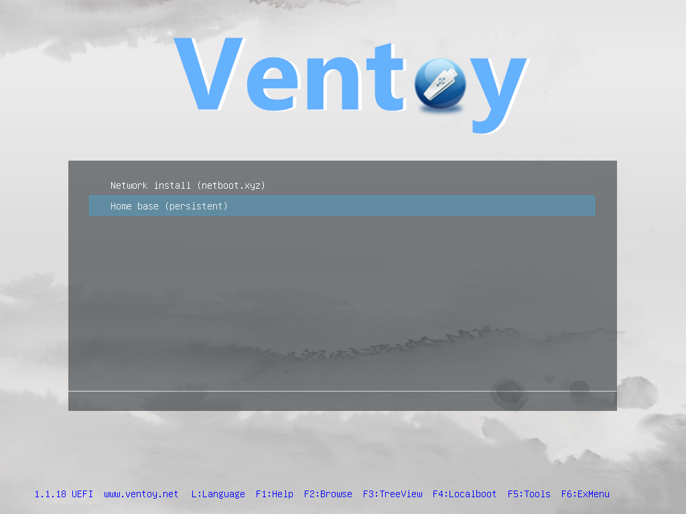

# one-os

> One tool to build, boot, manage and deploy machines with the operating system that fits them, built from code and tested in QEMU before it touches hardware.

| | |
|---|---|
| **Build** | a manifest of pinned ISOs and tools, a Debian **home base**, the stick and a test image |
| **Boot** | from a USB stick or SD card (Ventoy, UEFI and BIOS), over the network (PXE), or from a plain image |
| **Manage** | a rescue system with your SSH key: look inside a machine that will not come up |
| **Deploy** | install Debian or Ubuntu onto another drive, SteamOS onto an NVMe drive, or clone a disk |

one-os began as *one-usb*: one stick that boots a persistent Linux home base and installs
other operating systems. The stick is still the fastest way in; it is now one of three
media. Why it lives in bashos: [ADR 0004](../docs/adr/0004-one-os.md). What comes next:
[bashOS and Amrchy as bootable systems](docs/epics/0001-bashos-and-amrchy.md).

**📖 Documentation: [docs/](docs/README.md)** — user guide (booting, home base, installing an
OS), operator guide (flash wizard, building, flashing), developer guide and reference.
Design: [PLAN.md](PLAN.md) and [docs/adr/](docs/adr/).



```
Firmware (UEFI or BIOS) → Ventoy menu
  ├─ 🏠 Home base (Debian live + persistence)   oneos-install / oneos-restock
  ├─ 🌐 netboot.xyz (iPXE → dozens of installers, wired Ethernet)
  └─ 💿 offline installers (Ubuntu, Fedora, Mint, Debian, Arch, Proxmox, your Windows ISO, …)
```

## Quick start

Requirements: Linux with `sudo`, or macOS/Windows with Docker Desktop (privileged
containers allowed). On Linux without the tools installed, use `USE_DOCKER=1`.

```bash
make builder      # build the builder container (skipped natively on Linux)
make fetch        # download + verify everything in manifest.yaml → cache/
make lightos      # build the home base ISO (20–60 min the first time)
make payload      # stage the stick's file tree → build/payload/
make image        # 16 GB sparse test image with Ventoy + payload
make test         # fast suite in QEMU (T00–T51)
```

`make help` lists every target. `make lint` runs shellcheck, ruff and the manifest checks.

## Flashing a real stick

### The wizard (macOS)

```bash
make wizard
```

Opens a local page (127.0.0.1, per-session token) that walks through it: checks this
Mac → builds/updates the home-base ISO and stick contents → lists removable USB/SD
disks with what's on them → builds the image sized for the one you pick → you type its
name, macOS's own authorization dialog (authopen) grants access to that one device, it
writes + verifies + ejects with a progress bar →
optionally boots the result in a window and checks login, desktop, persistence and the
control channel. Every flash is logged to `build/flash-history.jsonl`. It runs the same
scripts as the commands below, with the same safety checks.

### By hand

**Linux** runs Ventoy2Disk on the device directly:

```bash
make flash DEV=/dev/sdX
```

**macOS** has no Ventoy installer and Docker can't see USB/SD devices, so the builder
makes an image of *exactly* the device's size (sparse: only the payload is real data),
and the flasher writes just its data extents to the raw device and reads them back:

```bash
make card-image DISK=disk4          # no sudo; size read from diskutil
make flash DISK=disk4               # guarded write + verify; macOS asks for an admin password
sudo make card-boot DISK=disk4      # boot the card in QEMU, UEFI + BIOS, read-only
```

macOS lists built-in SD readers as "internal"; the guard accepts removable media on
USB or the SD reader and refuses the disk macOS runs from.

The guard refuses unless the device is given explicitly, is a whole disk, has nothing
mounted, is removable USB (`FLASH_ARGS=--i-know-this-is-not-usb` for external SSDs), and
you type its model name. The stick gets its **full** capacity — the payload is copied
in, not `dd`'d (ADR-0002).

## Adding ISOs

- **Ad hoc:** copy any ISO into `/ISO` on the stick's `Ventoy` partition. Done.
- **Pinned:** add it to `manifest.yaml` (`url` + `sha256`), then `make fetch payload`.
- **Windows / licensed media:** put it in `local-isos/` with the filename from the
  manifest (`windows11.iso`). CI never downloads or redistributes it.

## Restocking from the home base

```bash
sudo oneos-restock --list          # what the stick's manifest wants vs. has
sudo oneos-restock                 # fetch missing/outdated ISOs (verified, atomic)
sudo oneos-restock --add URL --sha256 SUM --alias "My distro"
sudo oneos-restock --backup-persistence
```

## Installing to another drive

| You have | Use |
|----------|-----|
| **Wired Ethernet** | Boot **netboot.xyz** from the menu and pick an installer. iPXE has no Wi-Fi. |
| **Wi-Fi only** | Boot the **home base**, connect to Wi-Fi, then `sudo oneos-install`. |

```bash
sudo oneos-install --target /dev/nvme0n1 --distro debian   # or ubuntu | arch
```

It refuses the disk the home base booted from, partitions GPT (BIOS boot + ESP + root),
bootstraps the distro, and installs GRUB for both UEFI (removable path) and BIOS.

## Live VMs (try, debug, demo)

`scripts/oneos-vm` starts named VMs from the stick image, the ISO or a physical stick,
and drives them through three control channels: QMP (screen, keys, power), the serial
console, and qemu-guest-agent (root commands and file copy, ADR-0004).

```bash
make run                                    # windowed VM 'run' — log in as user / live
scripts/oneos-vm wait run --agent
scripts/oneos-vm exec run -- uname -a      # root, in the guest
scripts/oneos-vm screenshot run            # PNG of the screen
scripts/oneos-vm stop run
```

`scripts/oneos-vm --help` lists everything (`status`, `wait --ready|--serial|--screen`,
`cp`, `keys`, `type`, `serial -f`, `console`, `--target 20G` for install tests, `--profile bios`).
`CLAUDE.md` and `.claude/skills/oneos-vm/` teach Claude Code the same workflow.

## Tests

| ID | What | Suite |
|----|------|-------|
| T00 | partition layout, payload checksums, `ventoy.json` schema, persistence image | fast |
| T10 | Ventoy menu shows our aliases (OCR) — UEFI + BIOS | fast |
| T20 | home base reaches `ONEOS-READY` — UEFI + BIOS, via Ventoy and straight from the ISO | fast |
| T21 | live user exists, password is `live`, Xfce session starts via autologin | fast |
| T22 | guest-agent control channel: root exec, exit codes, binary file round-trip | fast |
| T30 | persistence survives a reboot | fast |
| T40 | netboot.xyz resolves and connects to `boot.netboot.xyz` (pcap) — UEFI + BIOS | fast |
| T45 | netboot.xyz → Debian installer starts | nightly |
| T50 | `oneos-install` to a second disk, which then boots **without the USB** | fast |
| T51 | `oneos-install` refuses the boot stick | fast |
| T60 | `oneos-restock` restores a deleted ISO | nightly |
| T70 | Ubuntu Server ISO reaches its installer | nightly |
| T80 | Secure Boot + MOK enrollment | nightly |
| T90 | two payload builds are byte-identical | nightly |

Each test keeps its serial log, pcap, screendumps, QEMU log and result JSON in
`build/test-runs/<test>/`. Useful knobs: `ONEOS_ACCEL=kvm|tcg`, `ONEOS_TIMEOUT_SCALE`,
`ONEOS_KEEP=1` (keep overlays), `ONEOS_OVERLAY=nbd|fuse|raw`, `ONEOS_MIRROR`
(apt mirror for T50), `make test ARGS="-k t30 -v"`.

## Repository map

```
manifest.yaml         every external artifact, pinned + checksummed
config/               ventoy.json template, menu theme
lightos/              live-build tree for the home base (+ oneos-* tools)
scripts/              fetch, build, stage, install, flash, lint, bump
harness/              pytest + QEMU harness (qemu.py, overlay.py, netcap.py, …)
docker/               builder image
docs/                 ADRs, spike report, hardware checklist, troubleshooting
```

## Working with AI on this repo

Read `PLAN.md` and the ADRs first. Use the tests as the finish line ("make T30 pass").
Agents work on loop devices and qcow2 overlays only — never run `flash.sh` or
`oneos-install` against real hardware.
