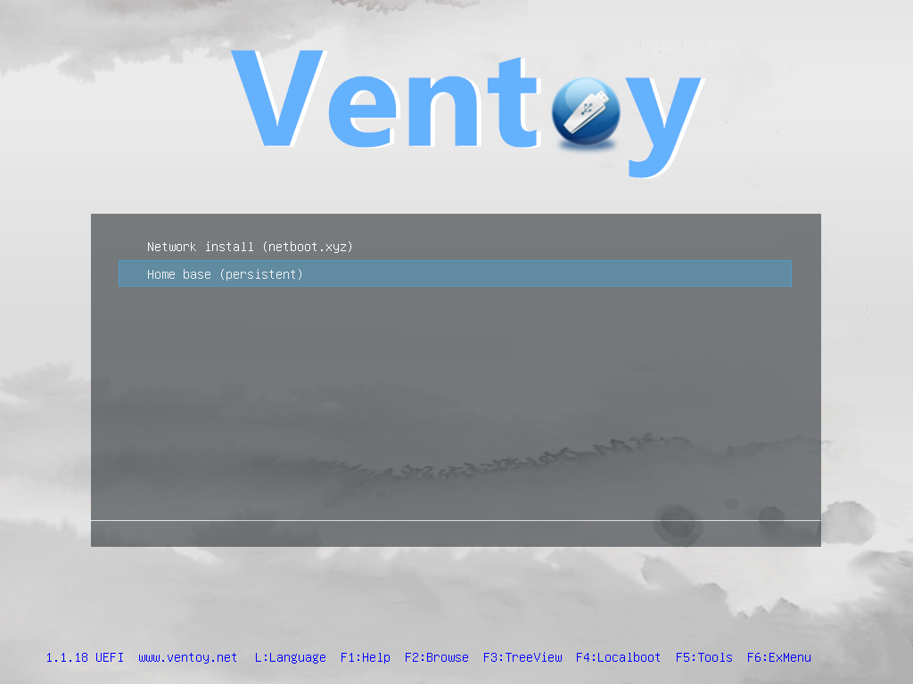

# one-os documentation

> The user, operator and developer guides for one-os: build, boot, manage and deploy machines from a USB stick, over the network, or with a plain image.

The quickest way in is the stick (or SD card): it boots a persistent Linux **home base**,
installs other operating systems over the network or from offline ISOs, and is built and
tested from code before it touches hardware.

## Pick your guide

| You want to… | Read |
|---|---|
| **Use a stick**: boot it, use the home base, install an OS | [User guide](user-guide/01-getting-started.md) |
| **Make a stick**: build, flash, verify | [Operator guide](operator-guide/01-flash-wizard.md) |
| **Change the project**: architecture, tests, VM tooling | [Developer guide](developer-guide/01-architecture.md) |
| Look up a command, file or setting | [Reference](reference/make-targets.md) |
| Fix a problem | [Troubleshooting](troubleshooting.md) |

## All pages

**User guide** — for whoever holds the stick
1. [Getting started](user-guide/01-getting-started.md) — what's on the stick, first boot in 5 minutes
2. [Booting on a PC](user-guide/02-booting.md) — boot-menu keys, UEFI vs BIOS, Secure Boot key enrollment
3. [The home base](user-guide/03-home-base.md) — desktop, login, persistence, Wi-Fi, built-in tools
4. [Network install with netboot.xyz](user-guide/04-network-install.md) — dozens of OS installers over Ethernet
5. [Install an OS onto another drive](user-guide/05-install-an-os.md) — `oneos-install`, works over Wi-Fi
6. [Adding and updating ISOs](user-guide/06-adding-isos.md) — drag-and-drop, `oneos-restock`, Windows
7. [Install SteamOS](user-guide/07-steamos.md) — Valve's recovery from the stick (F6), or over the network
- 🖨 [Quick reference card](user-guide/quick-reference.md) — one printable page: keys, login, commands

**Operator guide** — for whoever makes sticks
1. [The flash wizard](operator-guide/01-flash-wizard.md) — `make wizard`, step by step with screenshots
2. [Building the image](operator-guide/02-building.md) — the pipeline, timings, Docker on macOS
3. [Flashing from the command line](operator-guide/03-flashing-cli.md) — Linux and macOS, safety guards
4. [Maintenance](operator-guide/04-maintenance.md) — updating pins, refreshing sticks, release checklist
5. [The network boot server](operator-guide/05-network-boot-server.md) — PXE from your Mac: run, change, troubleshoot, SteamOS over the LAN

**Developer guide** — for whoever changes the project
1. [Architecture](developer-guide/01-architecture.md) — boot chain, disk layout, build and flash flows (diagrams)
2. [Testing](developer-guide/02-testing.md) — the QEMU harness, test catalogue, CI
3. [Live VMs and debugging](developer-guide/03-vm-tooling.md) — `oneos-vm`, control channels, debugging recipes
4. [Working with Claude Code](developer-guide/04-claude-code.md) — CLAUDE.md, the skill, guard rails

**Reference**
- [Make targets](reference/make-targets.md) · [oneos-vm CLI](reference/oneos-vm.md) ·
  [On-stick tools](reference/stick-tools.md) · [manifest.yaml](reference/manifest.md) ·
  [Stick layout and ventoy.json](reference/stick-layout.md) · [Environment variables](reference/environment.md)

**Records and decisions**
- [Design plan](../PLAN.md) · [ADRs](adr/) · [Phase 0 spike report](spike.md)
- [Hardware checklist](hardware-checklist.md) · [Hardware results](hardware-results.md)
- Epics: [bashOS and Amrchy as bootable systems](epics/0001-bashos-and-amrchy.md) (next)
- Field reports: [SteamOS on an X870E desktop — "No networks found" (2026-11-12)](field-reports/2026-11-12-steamos-silent-network.md)

## Screenshots

Screenshots in `docs/images/` are captured from real VMs and the real wizard by
`make docs-screenshots` (see [tools/](tools/)). Pages that show sample data (a flash in
progress, a finished flash) say so in their captions.
