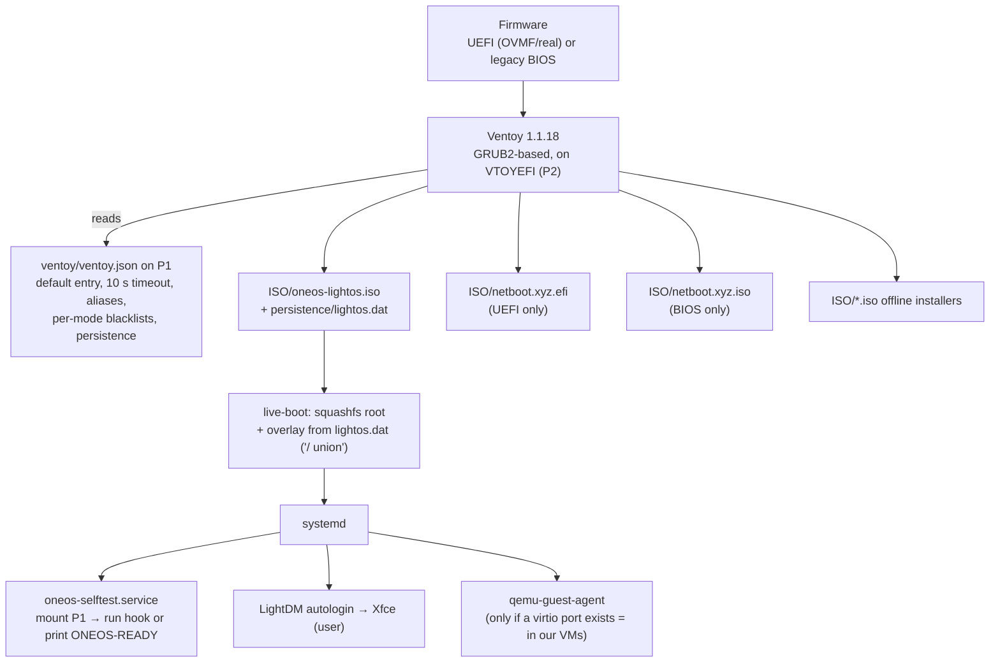
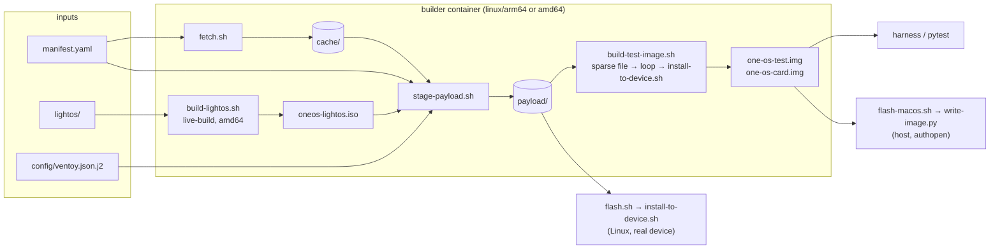
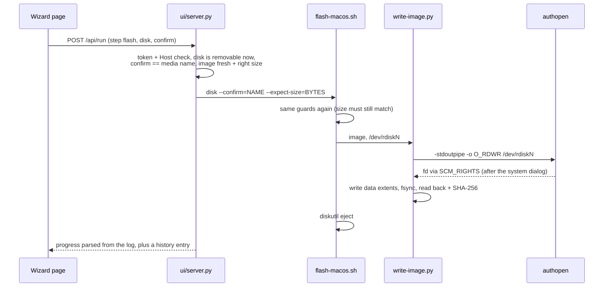

# Architecture

Design rationale lives in [PLAN.md](../../PLAN.md) and the [ADRs](../adr/); this page
shows how the pieces fit together today.

## Boot chain



Key settings in `ventoy.json` (rendered from `config/ventoy.json.j2`):
`VTOY_DEFAULT_SEARCH_ROOT=/ISO`, `VTOY_MENU_TIMEOUT=10`, `VTOY_DEFAULT_IMAGE=/ISO/oneos-lightos.iso`,
`VTOY_LINUX_REMOUNT=1` (lets the booted OS mount P1), `VTOY_SECONDARY_BOOT_MENU=0`,
`persistence … autosel 1, timeout 3`, `image_blacklist_uefi`/`_legacy` to show the right
netboot build per firmware mode. Each of these fixed a concrete problem — see the [spike report](../spike.md).

## Disk layout

```
 ┌───────────────────────────────────────────────────────────────────────────┐
 │ GPT  (protective MBR + Ventoy boot code in sectors 0–2047)                │
 ├───────────────────────────────────────────────────────────────────────────┤
 │ P1  label "Ventoy"   exFAT   rest of the device                           │
 │    /ISO/oneos-lightos.iso        home base (1.2 GB)                      │
 │    /ISO/netboot.xyz.efi|.iso      netboot.xyz (UEFI | BIOS)               │
 │    /ISO/*.iso                     offline installers, your ISOs           │
 │    /persistence/lightos.dat       ext4 image, label "persistence" (4 GB)  │
 │    /ventoy/ventoy.json            menu config                             │
 │    /oneos/manifest.yaml          what belongs here (for oneos-restock)  │
 │    /oneos/selftest/              test hook + results (ADR-0003)          │
 ├───────────────────────────────────────────────────────────────────────────┤
 │ P2  label "VTOYEFI"  FAT 32 MB    Ventoy EFI loaders, MOK key (.cer)       │
 ├───────────────────────────────────────────────────────────────────────────┤
 │ backup GPT (last 33 sectors)                                              │
 └───────────────────────────────────────────────────────────────────────────┘
```

Details and the `ventoy.json` format: [stick layout](../reference/stick-layout.md).

## Build pipeline



**One install path** (ADR-0002): `install-to-device.sh` runs Ventoy2Disk and copies the
payload — on a loop device for tests and on a real stick on Linux. macOS can't run
Ventoy2Disk on hardware, so it gets a device-sized image built by the same routine and a
verified extent copy.

## Flash on macOS



## Runtime tools on the stick

| Tool | Role |
|---|---|
| `oneos-selftest` (+ `.service`) | at boot: mount P1, run `/oneos/selftest/run.sh` if present (tests), else print `ONEOS-READY` to ttyS0 |
| `oneos-mount-p1` | mount P1 even while Ventoy's device-mapper holds it (falls back to a dm-linear view) |
| `oneos-install` | install Debian/Ubuntu/Arch to another disk; refuses the boot stick |
| `oneos-restock` | keep `/ISO` in line with the stick's manifest; verified, atomic downloads |
| `qemu-guest-agent` | control channel in VMs only (ADR-0004) |

## Repository map

```
manifest.yaml       pins (URL + sha256) for everything external
config/             ventoy.json template, theme
lightos/            live-build tree (auto/config, package lists, hooks, included files)
scripts/            fetch, build-lightos, stage-payload, install-to-device, build-test-image,
                    flash (Linux), flash-macos + write-image (macOS), card-boot, lint, bump,
                    oneos-vm, oneos-wizard
ui/                 flash wizard (server.py + index.html)
harness/            pytest harness: qemu.py, qga.py, overlay.py, serial.py, netcap.py,
                    screen.py, cli.py; tests/
docker/             builder image
docs/               this documentation, ADRs, spike, hardware records, tools/ (screenshot capture)
../.github/workflows/one-os.yml   lint + fast suite on PRs that touch one-os/; full matrix by hand
```
