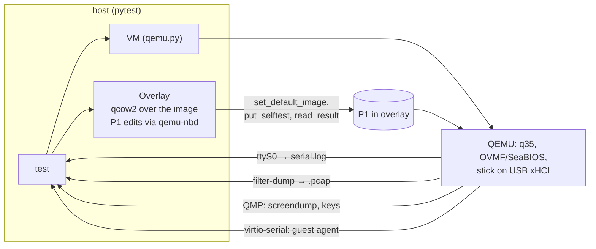

# Testing

Every feature is proven in QEMU before hardware: the harness boots the real stick image
in UEFI and BIOS, drives it, and asserts on the serial console, the network, the screen
and the guest itself.

```bash
make test                         # fast suite (~30 min under TCG on Apple Silicon, faster with KVM)
make test ARGS="-k t30 -v"        # one test
make test-full                    # + nightly tests
make test-image                   # T00 only (no VM)
```

On macOS, tests run inside the builder container (QEMU there uses TCG; timeouts are
scaled ×8). On Linux CI with KVM they run natively.

## How a test talks to the stick



Three ways to drive the guest:

| Mechanism | Use when | API |
|---|---|---|
| **Serial oracle** — the guest prints markers on ttyS0 | boot milestones | `vm.wait_serial(r"ONEOS-READY", 120)` |
| **Self-test hook** (ADR-0003) — script on P1 runs at boot, writes JSON, powers off | flows across reboots, unmodified boots | `selftest(make_vm, overlay, name, script)` |
| **Guest agent** (ADR-0004) — root exec + files, live | anything interactive | `vm.wait_agent(); vm.exec("…", check=True)` |

Plus `netcap.read(vm.pcap)` for DNS/TCP assertions and `screen.wait_text(vm, "…")` (OCR) for
graphical menus.

## Test catalogue

| ID | Test | Firmware | Asserts | Suite |
|---|---|---|---|---|
| T00 | `test_00_image` | — | partitions (Ventoy exFAT + 32 MB VTOYEFI), payload checksums, `ventoy.json` schema, persistence image label + `/ union` | fast |
| T05 | `test_05_machines` | — | `machines/` lints; `oneos-machine check` reports the X870E's MT7927 Wi-Fi missing on SteamOS 3.8, every known chip driven on a 7.2 kernel, exit 2 with no network chip | fast |
| T10 | `test_10_boot_menu` | UEFI, BIOS | OCR finds "Home base" and "Network install" | fast |
| T20 | `test_20_lightos` | UEFI, BIOS | bare `ONEOS-READY` via Ventoy (P1 mountable); ISO boots without Ventoy | fast |
| T21 | `test_desktop_autologin` | UEFI | `user` exists, password `live`, Xfce session running | fast |
| T22 | `test_22_agent` | UEFI | guest-agent exec, exit codes, stderr, binary file round trip | fast |
| T30 | `test_30_persistence` | UEFI | token written in boot 1 read back in boot 2 | fast |
| T40 | `test_40_netboot` | UEFI, BIOS | pcap: DNS query for `boot.netboot.xyz` + TCP connect to it | fast (needs internet) |
| T45 | netboot → Debian installer | UEFI | keystroke-driven, OCR | nightly (xfail) |
| T50 | `test_install_to_target…` | UEFI | `oneos-install` to a second disk, then that disk boots **without the USB** (`ONEOS-INSTALLED-OK`) | fast |
| T51 | `test_install_refuses_own_disk` | UEFI | refusal + stick's first MiB unchanged | fast |
| T60 | `test_60_restock` | UEFI | deleted ISO restored with the right sha256 | nightly |
| T70 | `test_70_offline_iso` | UEFI | Ubuntu Server reaches its installer (OCR) | nightly |
| T80 | `test_80_secure_boot` | UEFI+SB | MOK enrollment then `ONEOS-READY` | nightly (xfail) |
| T90 | `test_90_reproducible` | — | two `stage-payload` runs give identical checksums | nightly |

## Artifacts

Each test gets `build/test-runs/<test>/`: `*.serial.log`, `*.pcap`, `*.qemu.log`,
`*.cmdline`, screendumps, selftest `*.result.json`. Overlays are deleted on success and
kept on failure (or always with `ONEOS_KEEP=1`). CI uploads them when a job fails.

## Writing a test

```python
import pytest
pytestmark = pytest.mark.vm

def test_firefox_is_installed(overlay, make_vm):
    overlay.set_default_image("/ISO/oneos-lightos.iso", timeout=1)   # auto-boot the home base
    with make_vm(profile="uefi", usb_image=overlay.path, name="ff", net=False) as vm:
        vm.wait_agent(timeout=180)                                    # scaled for TCG
        assert vm.exec("command -v firefox-esr").rc == 0
```

Tips: reproduce in a live VM first ([VM tooling](03-vm-tooling.md)); wait for the concrete
thing (a process, a file, a marker), never a fixed time; keep tests independent (each gets
a fresh overlay).

## CI

| Workflow | When | Runs |
|---|---|---|
| `one-os.yml` → `lint`, `build + fast suite` | pull requests and `main`, only when `one-os/**` changes | lint; fetch + home-base ISO; `make payload image`; fast suite with KVM and an apt cache; failure artifacts |
| `one-os.yml` → `full matrix` | by hand (*Run workflow*, tick **full**) | full matrix incl. large ISOs |
