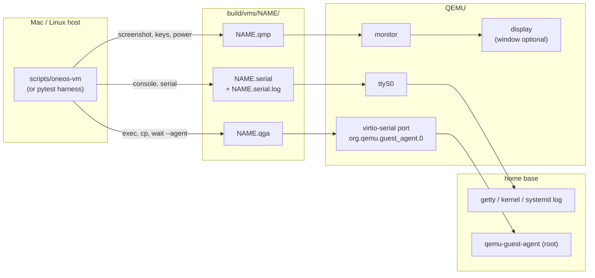

# Live VMs and debugging

`scripts/oneos-vm` runs named VM instances on the host (no Docker) and gives you — or
Claude Code — every way into them: commands as root, files, the screen, the keyboard and
the serial console. A human can watch the same instance in a window.



## Lifecycle

```bash
scripts/oneos-vm start dev                    # headless; card image (or test image) via overlay
scripts/oneos-vm start dev --window           # same, with a window to watch
scripts/oneos-vm wait dev --agent             # userspace up (~90 s under TCG)
scripts/oneos-vm status dev                   # state, READY marker, agent, last serial lines
scripts/oneos-vm stop dev                     # clean poweroff (agent, else ACPI)
scripts/oneos-vm start dev                    # again: overlay kept → your changes persist
scripts/oneos-vm start dev --fresh            # discard overlay/NVRAM first
scripts/oneos-vm list ; scripts/oneos-vm rm dev
```

Shapes: `--profile bios|uefi-sb`, `--iso build/oneos-lightos.iso` (no Ventoy),
`--target 20G` (empty `/dev/vda` to install onto) then `--no-usb` (boot only that disk),
`--no-net`, `--mem`, `--smp`, and `sudo … --disk diskN` for a physical stick (read-only
unless `--write`). `make run` is `start run --window`.

When the stick image is rebuilt, the next `start` notices and makes a fresh overlay
(an overlay is only valid on the exact image it was made from).

## Doing things inside

```bash
scripts/oneos-vm exec dev -- 'systemctl --failed; journalctl -b -p warning --no-pager | tail -50'
scripts/oneos-vm exec dev --timeout 900 -- 'apt-get update && apt-get install -y htop'
scripts/oneos-vm cp dev vm:/var/log/Xorg.0.log build/
scripts/oneos-vm cp dev ./fix.sh vm:/root/fix.sh
```

`exec` runs as root via `/bin/sh -c` and passes the exit code through. Everything after
`--` is the guest command.

## Screen, keyboard, serial

```bash
scripts/oneos-vm screenshot dev               # prints a PNG path
scripts/oneos-vm keys dev ctrl-alt-f2         # QMP qcodes: ret esc tab spc up down f1…f12
scripts/oneos-vm type dev 'user\n'
scripts/oneos-vm wait dev --screen "Home base"   # OCR (needs tesseract)
scripts/oneos-vm serial dev -n 80             # kernel + systemd + markers
scripts/oneos-vm serial dev -f                # follow
scripts/oneos-vm console dev                  # interactive ttyS0 (Ctrl-] to leave); login user/live
scripts/oneos-vm console dev --send '\n' --read 3   # scripted
```

## Debugging recipes

**Boot hangs.** `serial -n 80`: if the last lines are Ventoy/GRUB (or nothing), the problem is
before Linux — take a `screenshot` (Ventoy menu, persistence prompt and GRUB are screen-only).
If systemd is running, `exec` will work once the agent is up: `systemctl list-jobs`.

**Desktop is black.** Processes appear minutes before Xfce paints under TCG. Check
`exec dev -- 'ps -u user -o etime,comm'`; `tail ~/.xsession-errors` (as user's home);
take screenshots until one has content (a black 1280×800 PNG is ~3 KB; the desktop ~20 KB).

**Login fails.** `exec dev -- 'getent passwd user; journalctl -b -u lightdm'`; getty on
tty2 (`keys dev ctrl-alt-f2` + `screenshot`) shows autologin errors.

**Agent never answers.** The image may predate the agent (`dpkg -l qemu-guest-agent`),
or the guest hasn't reached userspace (`serial`). `wait --agent` holds one connection and
re-sends the sync; don't loop on short reconnects (it wedges some QEMU versions).

**A harness test failed.** Its artifacts are in `build/test-runs/<test>/`. Reproduce with a
named instance, fix, then rerun just that test (`make test ARGS="-k <name>"`).

## Instance files

```
build/vms/NAME/instance.json     pid, profile, source, start time
build/vms/NAME/usb.qcow2         overlay (your changes); usb.base = which image it belongs to
build/vms/NAME/NAME.serial.log   everything on ttyS0, appended across boots
build/vms/NAME/NAME.qemu.log     QEMU's own messages
build/vms/NAME/NAME.cmdline      exact QEMU command line
build/vms/NAME/NAME.pcap         network capture
build/vms/NAME/target.qcow2      install target (with --target)
```

Full option list: [oneos-vm reference](../reference/oneos-vm.md).
