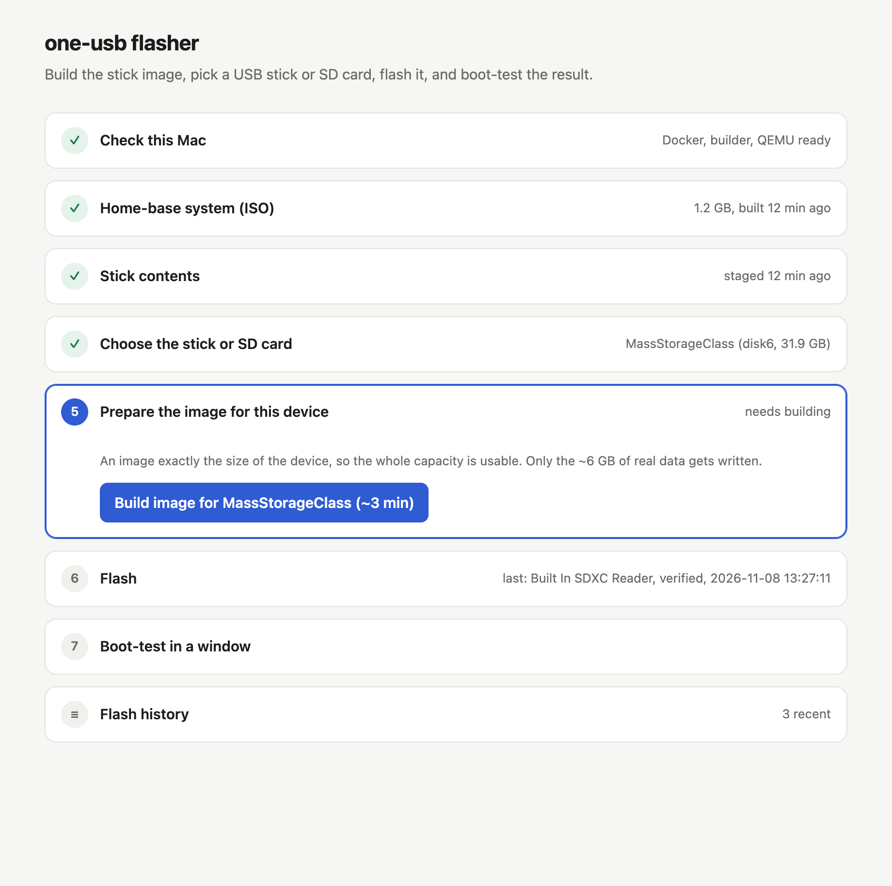
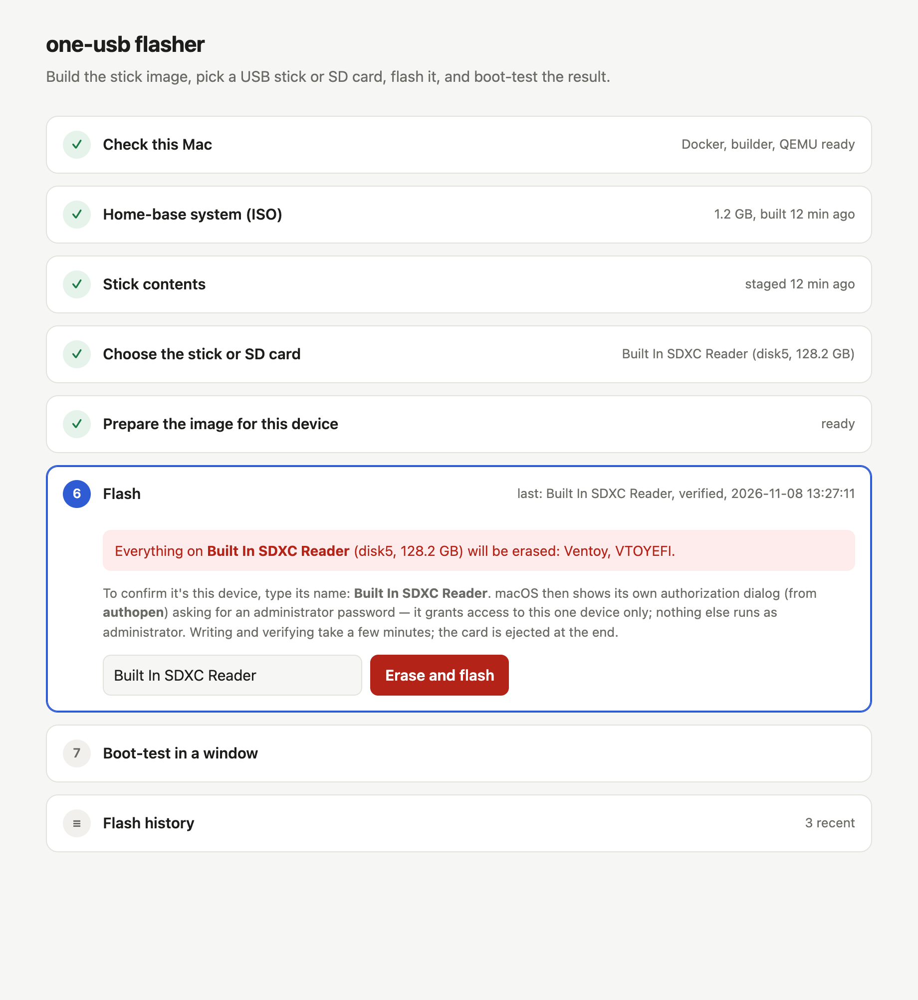
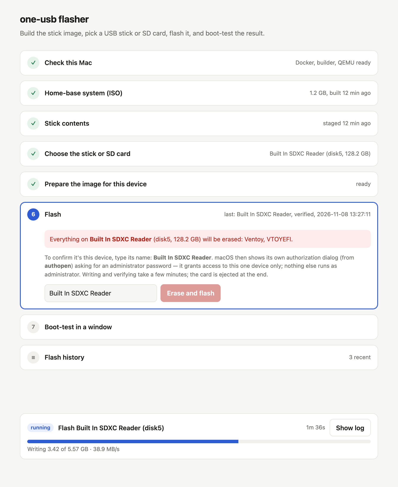
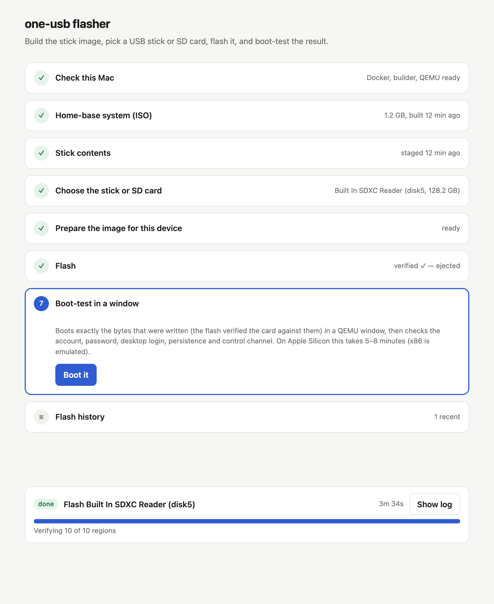
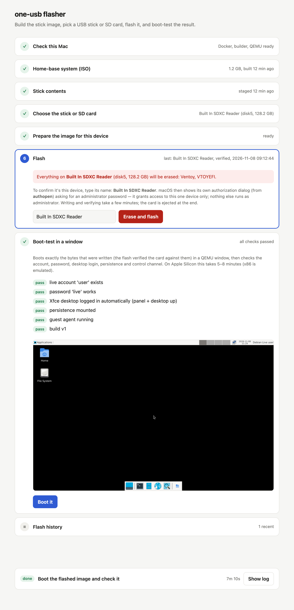
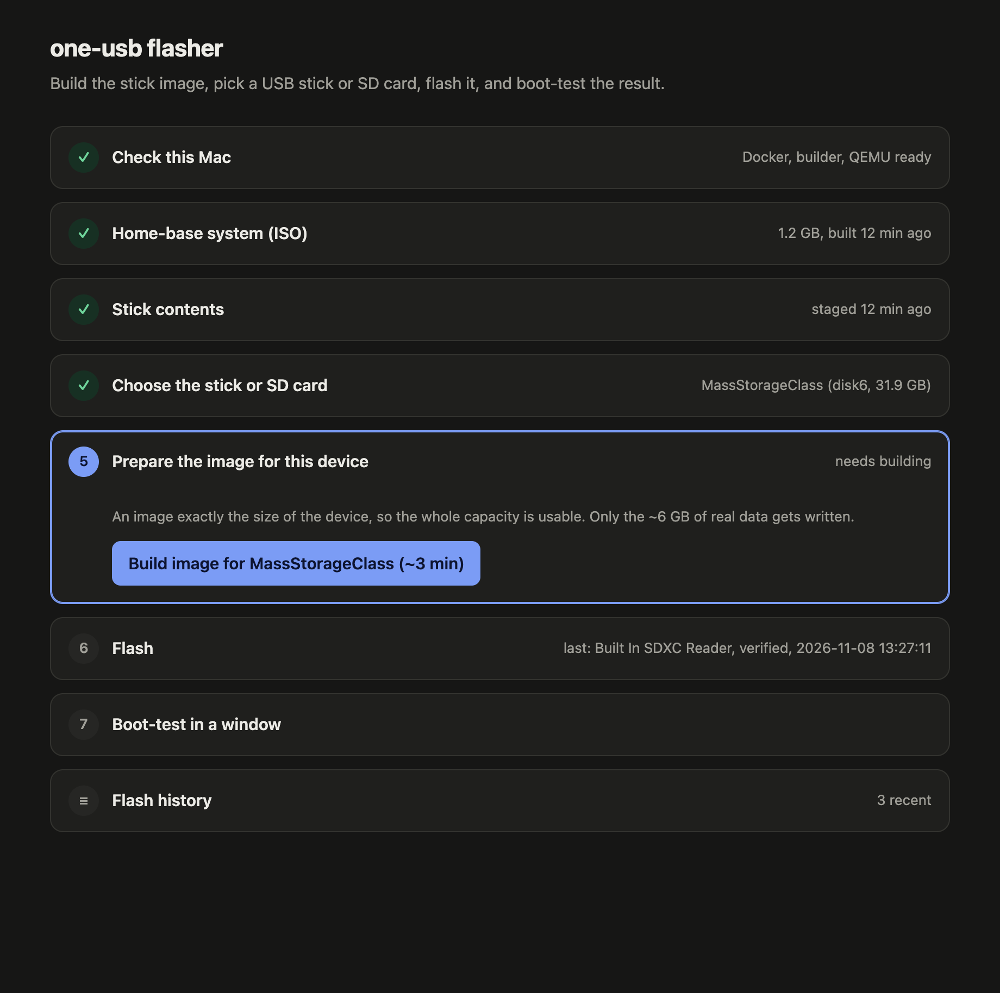

# The flash wizard

`make wizard` is the repeatable way to make a stick on a Mac: it checks the machine,
builds what's out of date, writes the stick, verifies it and boot-tests the result.

```bash
cd ~/github/one-os
make wizard
```

It prints a URL like `http://127.0.0.1:8765/?t=…` and opens it in your browser. Stop it
with **Ctrl-C** in that terminal. If 8765 is busy (another wizard is running) it takes the
next free port.



The page shows seven steps; finished steps get a ✓, and the next step to do is highlighted.
Click any step's title to open or close it.

## 1. Check this Mac

| Check | Why | Fix |
|---|---|---|
| macOS | the flasher uses macOS disk tools | — |
| Docker Desktop running | builds run in a Linux container | start Docker Desktop |
| builder image | the container with live-build, QEMU, … | **Build builder image** (one-time, ~5 min) |
| QEMU | for the boot test | `brew install qemu` |
| Free space ≥ 20 GB | ISO, images, test overlays | free some disk space |

## 2. Home-base system (ISO)

Shows when the ISO was built and whether it is **up to date** with the sources
(`lightos/`, `manifest.yaml`, the build scripts). **Build ISO** runs `make lightos`:
about **25 minutes** on Apple Silicon (the amd64 build runs under emulation), less on Intel/Linux.
**Re-download pinned files** runs `make fetch` (Ventoy, netboot.xyz, …; all checksum-verified).

## 3. Stick contents

**Stage files** assembles everything that goes on the stick (`make payload`, ~1 min):
the ISO, netboot.xyz, the persistence file, Ventoy's menu config and a copy of the manifest.

## 4. Choose the stick or SD card

Every removable USB or SD disk is listed with its name, size and **what's on it now**. A
stick that already has one-os on it is tagged *one-os stick*. Your choice follows the
device even if macOS gives it a new number (`disk5` → `disk6`) after re-inserting.

Internal disks and the disk macOS runs from are never listed.

## 5. Prepare the image for this device

**Build image** makes an image exactly the size of the chosen device (`make card-image`,
under a minute), so the whole capacity is usable. Only the ~6 GB of real data is ever
written; the rest is free space.

## 6. Flash



1. Read the red box: it names the device and everything on it that will be erased.
2. Type the device's name exactly as shown (e.g. `Built In SDXC Reader`). The button
   unlocks only when it matches.
3. Click **Erase and flash**.
4. macOS shows its own **authorization dialog (from "authopen")**: enter an administrator
   password. This grants access to *that one device* for *this one write*; nothing else
   runs as administrator, and no app gets permanent disk access.
5. Watch the progress: writing (~6 GB), then verifying every written region against the image.

   
   *Flash in progress (sample values).*

6. When it finishes, the device is **ejected** — it's safe to remove.

   
   *Finished and verified (sample values). Every flash is listed under Flash history.*

If you cancel the password dialog, nothing is written and the step shows *cancelled*.

## 7. Boot-test in a window

**Boot it** starts the exact bytes that were written (the flash verified the device
against them) in a QEMU window and checks, through the VM's control channel:

- the live account `user` exists and its password is `live`;
- the Xfce desktop logs in automatically (panel and desktop running);
- persistence is mounted;
- the guest agent is running; and shows the build stamp.


*Boot-test results (sample run; the screenshot is taken once the desktop has drawn).*

On Apple Silicon this takes 5–8 minutes (x86 is emulated). **Close test VM** shuts the window.
It's a check of the image, not of a particular PC — for that, boot the stick on hardware
([user guide](../user-guide/02-booting.md)) and record it in the
[hardware results](../hardware-results.md).

## Dark mode

The wizard follows the system appearance.



## Security model

| Concern | How it's handled |
|---|---|
| Other web pages driving the wizard | Server listens on `127.0.0.1` only; every request needs the per-run token from the printed URL and a localhost `Host` header (blocks DNS rebinding); no CORS. |
| Writing the wrong disk | Only removable USB/SD disks are offered; the disk macOS runs from is refused; you type the device name; the write is re-checked against the size you confirmed (a swapped card fails); the image must be built for that exact size. |
| Privilege | No `sudo`, no root shell. Only the device open is privileged, via macOS `authopen` and the system dialog. |
| Arbitrary commands | The API accepts a fixed list of steps; disk ids are validated (`diskN`). |
| Audit | Each job's full log is in `build/wizard/<time>-<step>.log`; flashes in `build/flash-history.jsonl`. |

## Troubleshooting

| Message | Meaning / fix |
|---|---|
| *'… is still running'* | One job at a time; wait or watch the log (**Show log**). |
| *the card image is missing, stale, or sized for another device* | Do step 5 for the selected device. |
| *… is not the N bytes the confirmation was for* | A different card was inserted after you confirmed — refresh and confirm again. |
| *macOS blocked the write* | Shouldn't happen with the authorization dialog; the fallback is to give the app you started the wizard from (Terminal, VS Code) Full Disk Access — the step has a button to open that settings pane. |
| Page says *missing or wrong token* | Use the full URL the wizard printed (it changes every run). |

The same steps are available without the browser: [command line](03-flashing-cli.md).
