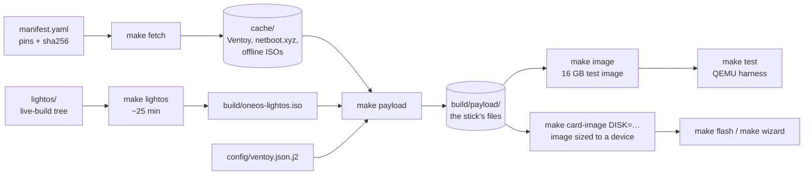

# Building the image

Everything on a stick is built from the repository: pinned downloads, a reproducible
home-base ISO and a staged file tree.



## Prerequisites

| | macOS | Linux |
|---|---|---|
| Tools | Docker Desktop (privileged containers allowed), Homebrew `qemu` | `make`, `sudo`; tools natively, or Docker with `USE_DOCKER=1` |
| Disk | ~20 GB free | same |
| First step | `make builder` (builds `oneos-builder:latest` and `:amd64`) | `make builder` if using Docker |

On macOS every Linux-only step (loop devices, exFAT, live-build) runs inside the builder
container automatically; on Linux the same scripts run natively with `sudo` where needed.

## The steps

| Command | Produces | Time (Apple Silicon) |
|---|---|---|
| `make fetch` | `cache/` — every external file, checksum-verified; refuses mismatches | seconds (cached) |
| `make lightos` | `build/oneos-lightos.iso` (+ `.sha256`) | ~25 min |
| `make payload` | `build/payload/` + `build/payload.SHA256SUMS` | ~1 min |
| `make image` | `build/one-os-test.img` (16 GB sparse; for tests) | ~1 min |
| `make card-image DISK=diskN` | `build/one-os-card.img`, exactly the device's size | ~1 min |
| `make lint` | shellcheck, ruff, manifest schema | seconds |
| `make test` | fast QEMU suite | ~30 min under emulation |

`make help` lists everything; see also the [make reference](../reference/make-targets.md).

## Customising the home base

| Change | Where |
|---|---|
| Desktop (`xfce`, `lxqt`, `none`) | `manifest.yaml` → `lightos.desktop` |
| Extra packages | `manifest.yaml` → `lightos.extra_packages`, or `lightos/config/package-lists/oneos.list.chroot` |
| Persistence size | `manifest.yaml` → `lightos.persistence_mb` |
| Files baked into the system | `lightos/config/includes.chroot/…` |
| Commands run while building | `lightos/config/hooks/live/*.hook.chroot` |
| Kernel command line | `lightos/auto/config` (`--bootappend-live`) |

The image is built with `--apt-recommends false` to stay small. **List anything a feature
needs explicitly** — missing Recommends have caused real failures (no X server; no user
account). After changing packages, rebuild and run `make test ARGS="-k 'home_base or autologin or agent'"`.

## Offline installers

`manifest.yaml` → `isos:` lists offline ISOs. Large ones (`large: true`, e.g. Ubuntu
Server) are only fetched with `FETCH_LARGE=1 make fetch`. User-supplied ones (Windows) are
never downloaded: put the file at `local-isos/<file name from the manifest>` (e.g.
`local-isos/windows11.iso`) and run `make fetch payload`.

## Reproducibility

Builds use `SOURCE_DATE_EPOCH` (2026-01-01) for timestamps, a fixed UUID and hash seed for
the persistence filesystem, and pinned checksums for every download, so two `make payload`
runs give identical checksums (test T90). The home-base ISO itself depends on the Debian
archive at build time.

## Where things go

```
cache/                      downloads (keyed by manifest; safe to keep)
build/oneos-lightos.iso    home-base ISO        build/payload/       stick file tree
build/one-os-test.img      16 GB test image     build/one-os-card.img  device-sized image
build/test-runs/<test>/     test artifacts       build/vms/<name>/    live VM instances
build/wizard/               wizard job logs      build/flash-history.jsonl
```

`make clean` removes images and test runs; `make distclean` also removes `cache/` and the ISO.
