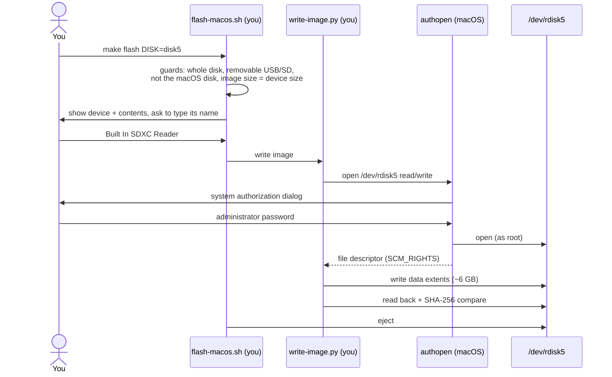

# Flashing from the command line

The wizard and these commands run the same scripts and the same checks.

## macOS

```bash
diskutil list external              # find the device; built-in SD readers show as "internal"
make card-image DISK=disk5          # image sized exactly for that device
make flash DISK=disk5               # guarded write + verify + eject (no sudo)
```



Only the device open is privileged. If you run `sudo make flash` instead, the write runs
as root directly — which macOS blocks unless the app you ran it from (Terminal, VS Code…)
has Full Disk Access; the no-sudo path doesn't need that.

### Why an image the size of the device?

macOS has no Ventoy installer, so the partition layout is made in the Linux builder on an
image file. Making that file exactly as large as the device puts Ventoy's partitions and
the backup GPT in the right places, so the whole device is usable. The file is sparse:
128 GB on paper, ~6 GB on disk, and only those ~6 GB are written. Regions that were never
written in the image are free space on the stick, so their old contents don't matter.

## Linux

```bash
lsblk -o NAME,SIZE,MODEL,TRAN,RM    # find the stick: TRAN usb, RM 1
make flash DEV=/dev/sdX
```

On Linux, Ventoy2Disk runs directly on the device and the staged payload is copied in.

## The guards (both platforms)

| Guard | Linux `flash.sh` | macOS `flash-macos.sh` |
|---|---|---|
| Device given explicitly, never auto-detected | ✓ | ✓ |
| Whole disk, not a partition | ✓ | ✓ |
| Not the disk the OS runs from | ✓ (`/`, `/boot`, `/boot/efi`) | ✓ (APFS container's physical store) |
| Nothing mounted / unmount first | refuses if mounted | unmounts, fails if busy |
| Removable USB (Linux) / USB or SD (macOS) | ✓, override `--i-know-this-is-not-usb` | ✓, override `--i-know-this-is-not-removable` |
| Type the model / media name | ✓ | ✓ (or the wizard's confirmation + size check) |
| Image built for this exact size | n/a | ✓ |
| Verify after writing | Ventoy + rsync | read-back SHA-256 of every written extent |

Pass overrides with `FLASH_ARGS=…`, e.g. `make flash DISK=disk7 FLASH_ARGS=--i-know-this-is-not-removable`
for an external SSD.

## Check a flashed stick without hardware

```bash
sudo make card-boot DISK=disk5      # boots the device in QEMU, UEFI then BIOS, read-only
sudo scripts/oneos-vm start card --disk disk5 --window   # same, interactive window
```

These read the device, so they need root. The wizard's boot test avoids that by booting the
verified image instead.

## Re-inserted cards change numbers

macOS assigns `diskN` on insertion. If a command says *no such disk*, it lists the
removable disks present now — use the new number.
