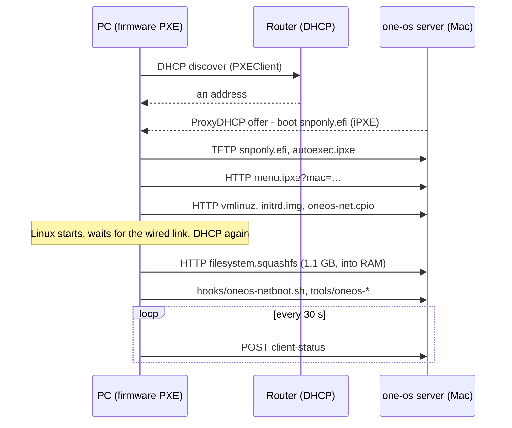

# The network boot server (PXE)

Boot PCs on your LAN over Ethernet with no stick at all: they get the one-os menu from
your Mac (or any Linux machine with the repo), run the home base in RAM, and can install
SteamOS onto their M.2 drive. The server is `netboot/server.py`: plain Python, no installs,
runs as your user.

The server **never hands out addresses** (ProxyDHCP): your router stays the DHCP server,
and only PCs that ask for a network boot get an answer.

## Day-to-day

| Do | Command |
|---|---|
| First time / after `make lightos` | `make netboot` (extracts the home base into `build/netboot/`) |
| Start in the background | `make pxe-start` (or `make pxe-start IFACE=en0`) |
| Is it running, which address, which PCs | `make pxe-status` |
| Follow events live | `make pxe-logs ARGS=-f` |
| Restart after editing `server.py` | `make pxe-restart` (check `pxe-status` first: a PC mid-download loses it) |
| Stop | `make pxe-stop` |
| Start at login, restart if it dies (macOS) | `scripts/pxe.sh agent-install` (undo: `agent-remove`) |
| Foreground, for debugging | `make pxe-server IFACE=en0` |
| Cache the SteamOS image (3.4 GB) | `make steamos-fetch` |

The server follows the Mac's address: if Wi-Fi roams or DHCP renews to a new address, PXE
replies switch to it within 15 s (an event says so). macOS may ask once to allow incoming
connections for Python — allow it.

## Changing things (no restart needed)

The server reads these on every request; edit, save, and the next PC boot uses them.

| To change | Edit | Notes |
|---|---|---|
| Menu entries, default, timeout, kernel options | `netboot/boot.ipxe` | `{srv}` etc. are filled per client; literal iPXE braces are doubled (`${{net0/mac}}`) |
| Early-boot fixes (before the network is up) | `netboot/initrd/` | sent as a second initrd (`/live/oneos-net.cpio`); keep paths under `usr/lib/…` (`/lib` is a symlink) |
| What runs at boot on every netbooted PC | `netboot/hooks/oneos-netboot.sh` | live-config hook, runs as root: screen never blanks, status reports, tools refresh |
| The one-os tools (`oneos-steamos`, …) | `lightos/config/includes.chroot/usr/local/bin/` | netbooted PCs download the repo's current copies at boot — fixes need no ISO rebuild |
| Which SteamOS image is deployed | `cache/steamos/SELECTED` (a filename), else the newest | `make steamos-capture DISK=diskN` turns a working stick into an image |

Changes to `netboot/server.py` itself need `make pxe-restart`. Changes to the kernel,
packages or desktop need `make lightos netboot` (~25 min).

## What it keeps

`build/netboot/`:

- `server.log` — every event (DHCP, TFTP, HTTP, installer reports, status changes)
- `clients/<mac>/status.txt` — the latest 30-second snapshot from a running home base:
  desktop and display state, GPU, disks, memory, the SteamOS installer's log, kernel and
  journal errors; `history.log` — one line per change. Also at
  `http://<server>:8780/client-status?mac=<mac>`.
- `installs.json` — PCs that got SteamOS from this server; their menu defaults to *Boot
  from local disk* afterwards.

## Requirements on the PC

- **UEFI network boot on, Secure Boot off.** Debian's iPXE loader is unsigned: with Secure
  Boot on, firmware shows a *Secure Boot violation*. SteamOS doesn't support Secure Boot
  either.
- **Wired Ethernet on the same LAN segment as the server.** Wi-Fi → wired broadcasts don't
  cross some mesh systems; if `make pxe-status` never lists the PC's `PXEClient`, plug the
  Mac into the same switch.
- **A port Linux has a driver for.** Firmware can PXE-boot from ports the home base's
  kernel can't drive. Since the backports kernel (7.x) this covers the Realtek RTL8127; if
  a PC stops at *waiting for a link*, the screen now says which port to use.
- **For SteamOS: an AMD GPU** (Radeon RX 6000–9000, Ryzen iGPU) and the NVMe drive as
  `nvme0n1`. NVIDIA cards are not supported by SteamOS.

## Troubleshooting

| Symptom | Cause → fix |
|---|---|
| Nothing in `pxe-status` when the PC boots | Broadcasts don't reach the server (Wi-Fi/mesh) or the server is on another interface: `make pxe-restart IFACE=…` |
| *Secure Boot violation* | Turn Secure Boot off in the firmware |
| Menu loads, *Network unreachable* after firmware HTTP boot | Fixed in `autoexec.ipxe` (`ifopen net0`); restart an old server |
| Kernel and initrd load, then nothing; screen says *waiting for a link on …* | Cable in a port without a Linux driver, or a slow 2.5/5/10 GbE link: move the cable, or add `oneos.linkwait=180` to the menu |
| Screen goes black after the kernel starts | Pick *safe graphics (nomodeset)* |
| SteamOS install stops at *Finalizing EFI system partition* | Old installer without UEFI variables in its chroot: reboot the PC (it fetches the fixed tool) |
| A PC with SteamOS boots the menu again | Its default is *local disk* after 20 s; or remove it from `installs.json` to reinstall |
| PCs wait *for the PXE server* forever, `pxe-status` says running, `server.log` shows no `dhcp` lines | The ProxyDHCP listener died (servers before 2026-11-12 ended the listener on one failed send, e.g. `No route to host` during a Wi-Fi blip). Check `lsof -nP -iUDP -a -p $(cat build/netboot/server.pid)` lists `*:67`; `make pxe-restart`. Fixed: send errors are logged as `offer … failed` and the listener keeps running |

Status snapshots and `server.log` are the first place to look; the PC's screen shows
early-boot messages (the monitor is the main console, serial gets a copy).

## Running it without the Mac (planned)

The home base carries the repository (`oneos-clone`), and `server.py` runs on Linux too
(`sudo python3 netboot/server.py --pxe`: ports below 1024 need root there). What's missing
is the netboot files on the stick (`build/netboot/`, ~1.3 GB) — not staged yet.
