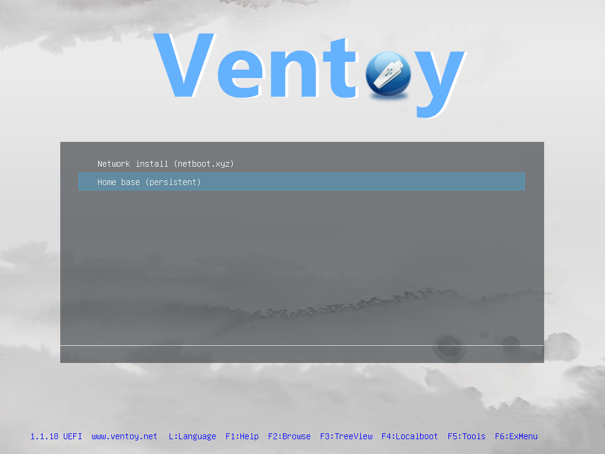
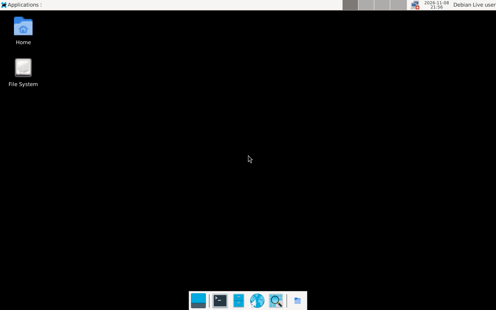

# Getting started

A one-os stick boots almost any 64-bit PC into a menu of operating systems. Nothing on
the PC's own drives changes unless you choose to install something.

## What's on the stick

| Menu entry | What it is | Needs |
|---|---|---|
| **Home base (persistent)** | A Debian 13 desktop (Xfce) with repair and install tools. Files and settings you change are kept between boots. | — |
| **Network install (netboot.xyz)** | A menu of installers for dozens of Linux distributions and utilities, downloaded on demand. | Wired Ethernet |
| **Linux installers** *(if included)*: Ubuntu Desktop/Server, Debian, Fedora, Mint, Arch, Proxmox VE, SystemRescue | Offline installers and rescue tools ([list](06-adding-isos.md#linux-installers-on-the-stick)). | — |
| **Windows 11 setup** *(if your operator added it)* | Offline installer from your own ISO. | — |
| Any other `.iso` you copy onto the stick | Booted directly by Ventoy. | — |

The stick uses its whole capacity: a 128 GB card has ~120 GB free for your own ISOs and files.

## First boot in five minutes

1. **Plug the stick into the PC** (a USB port, not a hub, is most reliable).
   *SD cards*: many PCs can't boot from a built-in SD slot — use a USB SD-card adapter.
2. **Turn the PC on and open its boot menu** — usually by tapping **F12**, **F11**, **F9**,
   **F8** or **Esc** right after power-on. [Keys by manufacturer →](02-booting.md#boot-menu-keys)
3. **Pick the USB device.** If it appears twice, prefer the one starting with **UEFI:**.
4. **The Ventoy menu appears.** After 10 seconds it starts the home base on its own;
   use ↑/↓ and Enter to pick something else.

   

5. **Secure Boot PCs only, first time:** a blue screen says *Verification failed*. Enroll
   the stick's key once — [step-by-step](02-booting.md#secure-boot-first-time-only) — after
   which it boots normally on that PC.
6. **The home base desktop appears** about a minute later, already logged in.

   

The account is **`user`**, password **`live`** (needed for the lock screen and `sudo`).

Keep the one-page [quick reference](quick-reference.md) with the stick.

## What next?

- Look around the home base and its tools → [The home base](03-home-base.md)
- Install an operating system onto the PC → [Network install](04-network-install.md) (Ethernet)
  or [`oneos-install`](05-install-an-os.md) (works over Wi-Fi)
- Add your own ISOs → [Adding ISOs](06-adding-isos.md)

## Safety in one paragraph

Booting the stick changes nothing on the PC. The home base doesn't mount the PC's drives
unless you open them. The only tools that write to another drive — `oneos-install`, GParted,
TestDisk — tell you which drive they'll change and ask first, and `oneos-install` refuses
to touch the stick it booted from.
