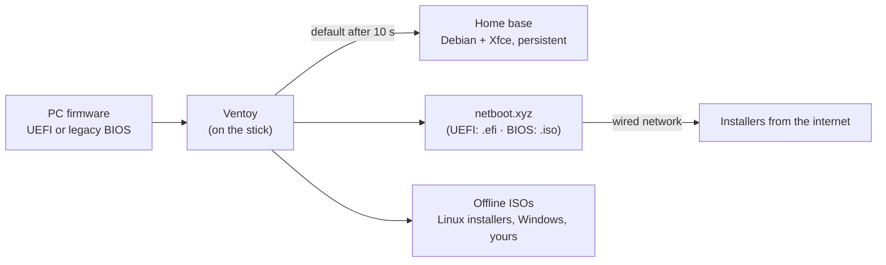
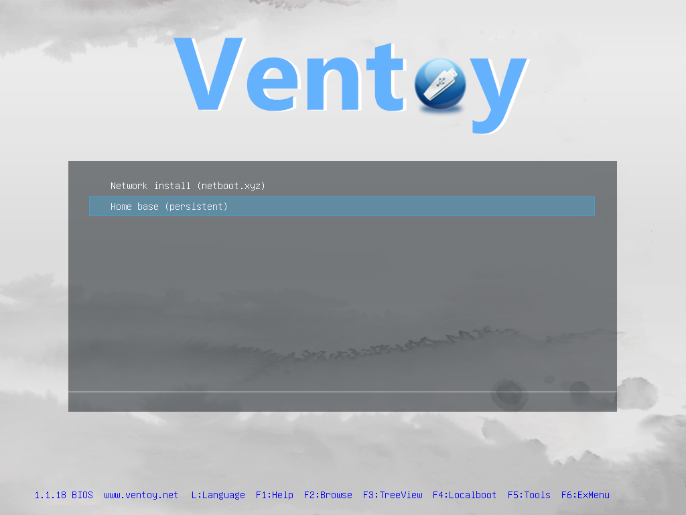

# Booting on a PC

## How booting works (one picture)

The PC's firmware starts **Ventoy**, a boot manager on the stick. Ventoy lists every ISO
on the stick and starts the one you pick without unpacking it.

## Boot-menu keys

Tap the key repeatedly right after pressing the power button. If Windows starts instead,
shut down fully (hold **Shift** while clicking *Shut down*, to skip Fast Startup) and retry.

| Manufacturer | One-time boot menu | Firmware setup |
|---|---|---|
| Dell | **F12** | F2 |
| HP | **F9** (or Esc, then F9) | F10 |
| Lenovo ThinkPad | **F12** (or Enter, then F12) | F1 |
| Lenovo IdeaPad | **F12**, or the pin-hole *Novo* button | F2 |
| ASUS | **F8** or **Esc** | F2 / Del |
| Acer | **F12** (enable "F12 Boot Menu" in setup first) | F2 |
| MSI | **F11** | Del |
| Gigabyte | **F12** | Del |
| ASRock | **F11** | F2 / Del |
| Intel NUC | **F10** | F2 |
| Microsoft Surface | Hold **Volume Down**, press and release power | Volume Up + power |
| Intel Mac | Hold **Option (⌥)** at the chime | — |
| Apple Silicon Mac | *Not supported* (can't boot x86 systems) | — |

From a running Windows 10/11 you can also use *Settings → System → Recovery → Advanced
startup → Use a device*.

## UEFI or legacy BIOS?

The stick boots both ways and shows the same menu.

| | UEFI | Legacy BIOS (CSM) |
|---|---|---|
| Boot-menu entry | `UEFI: <stick name>` | `<stick name>` / `USB HDD` |
| Menu footer | `1.1.18 UEFI` | `1.1.18 BIOS` |
| netboot.xyz entry | runs `netboot.xyz.efi` | runs `netboot.xyz.iso` |
| Secure Boot | supported after one-time key enrollment | n/a |

Prefer UEFI on anything made after ~2012. OSes installed from a UEFI boot install in UEFI
mode, and vice versa.

## The Ventoy menu

| Key | Action |
|---|---|
| ↑ ↓, Enter | choose and boot an entry (any key stops the 10-second countdown) |
| F1 | Ventoy help |
| F2 | browse all files on the stick (boot ISOs outside `/ISO`) |
| F4 | boot the PC's own disk instead (*Localboot*) |
| F5 | Ventoy tools (check the image, show plugin config, power off) |
| F6 | extended menu |
| L | language |

When you start the **home base**, a second short prompt appears asking whether to boot
*with persistence*; it picks persistence after 3 seconds on its own.

## Secure Boot (first time only)

Ventoy is signed with its own key, which your PC doesn't trust yet. On the first boot with
Secure Boot on:

1. A blue screen: **Verification failed: (0x1A) Security Violation** → press **Enter (OK)**.
2. **Perform MOK management** → **Enroll key from disk**.
3. Select the volume **VTOYEFI** → the file **ENROLL_THIS_KEY_IN_MOKMANAGER.cer**.
4. **Continue** → **Yes** → **Reboot**.
5. Open the boot menu again and pick the stick. It now boots normally on this PC.

This adds Ventoy's key to the PC's *Machine Owner Key* list, not to the firmware's main
database; you can remove it later with `mokutil --delete` from any Linux. If your firmware
has no MOK support, turn Secure Boot off in firmware setup instead.

## When it doesn't boot

| Symptom | Fix |
|---|---|
| Stick not in the boot menu | Use a different port (USB-A on the board, not a hub). Enable *USB boot* in firmware setup. SD cards: use a USB adapter. |
| Only a non-UEFI entry | Firmware is in legacy mode, or CSM is off and the stick wasn't detected in UEFI — try another port. |
| "Verification failed" every time | You chose *Cancel* in MokManager. Repeat the enrollment above. |
| Black screen after choosing *Home base* | Wait 2 minutes on slow machines. Then try *Home base* again and, at the GRUB menu, pick the fallback/safe graphics entry if shown; or report the model (see [hardware results](../hardware-results.md)). |
| Ventoy menu but every ISO fails | The stick may be damaged; re-flash it ([operator guide](../operator-guide/01-flash-wizard.md)). |

More in [Troubleshooting](../troubleshooting.md).
