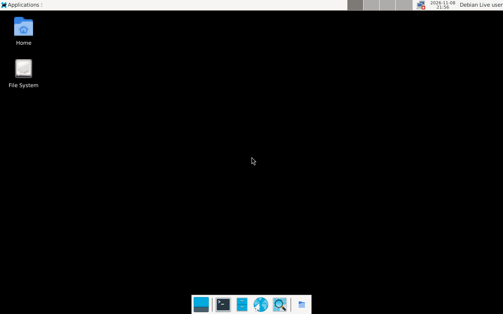
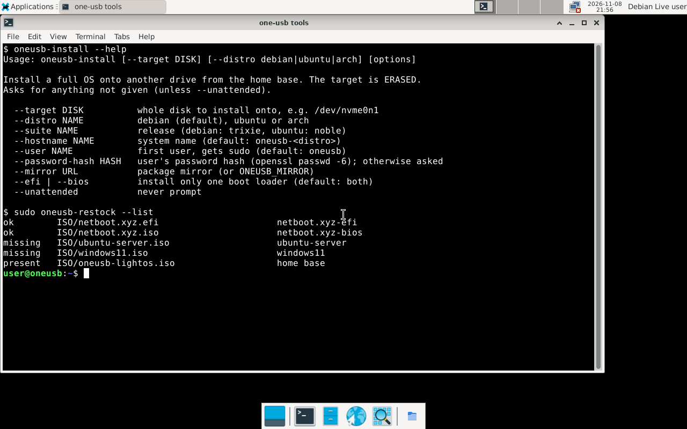

# The home base

The home base is a Debian 13 ("trixie") live system with the Xfce desktop, running from
the stick. It starts already logged in.



| | |
|---|---|
| User / password | **`user`** / **`live`** |
| Hostname | `oneos` |
| Administrator | `sudo <command>` (password `live`); `sudo oneos-restock` and `sudo oneos-install` don't ask |
| Persistence | 4 GB, on by default — see below |
| Serial console | `ttyS0` at 115200 baud also has a login (useful for headless machines) |

## Persistence: what survives a reboot

Everything you change under `/` — files in your home folder, installed packages, Wi-Fi
passwords, desktop settings — is written to `persistence/lightos.dat` on the stick and is
there next time. The system image itself is read-only, so a bad change can be undone:

| To… | Do |
|---|---|
| Boot once *without* your changes | At the "boot with persistence?" prompt (3 s after choosing *Home base*), choose the entry without persistence |
| Back up your changes | `sudo oneos-restock --backup-persistence` (copies to `persistence/lightos.dat.bak`) |
| Reset to factory state | Re-flash the stick, or replace `persistence/lightos.dat` from a fresh build |
| Get more space | Rebuild with a larger `lightos.persistence_mb` in `manifest.yaml` ([reference](../reference/manifest.md)) |

Always **shut down** from the menu (or `systemctl poweroff`) rather than pulling the stick:
the persistence file is a filesystem and can be damaged by a hard power-off.

## Networking

- **Wired**: works automatically.
- **Wi-Fi**: click the network icon in the panel and pick your network. Firmware for
  common Intel, Realtek, Atheros and Broadcom chips is included.
- From a terminal: `nmcli device wifi connect "<SSID>" password "<password>"`.

## What's installed



| Task | Tools |
|---|---|
| **one-os** | `oneos-install` (install an OS onto another drive), `oneos-restock` (download/verify ISOs onto the stick) — [reference](../reference/stick-tools.md) |
| Disks and partitions | GParted, `parted`, `gdisk`/`sgdisk`, `lsblk`, `blkid`, `wipefs` |
| Filesystems | ext2/3/4, exFAT, FAT, NTFS (`ntfs-3g`), Btrfs, XFS, LVM, LUKS (`cryptsetup`) |
| Rescue | TestDisk / PhotoRec (lost partitions, deleted files), `smartctl` (drive health), `rsync` |
| Boot repair | `efibootmgr`, GRUB (EFI and BIOS) |
| OS bootstrap | `debootstrap`, `arch-install-scripts` |
| Network | Firefox ESR, NetworkManager, `curl`, `openssh-client`, `iw` |
| Misc | `jq`, `yq`, `python3`, `nano`, `vim` |

Install anything else with `sudo apt install <package>`; with persistence on, it stays.

## Common jobs

**Check a drive's health**
```bash
sudo smartctl -H -A /dev/nvme0n1      # or /dev/sda
```

**Copy files off a PC that won't boot**
1. Open *File System* or the file manager, click the PC's drive in the side panel to mount it.
2. Copy to the stick's data partition (`Ventoy`, under the removable devices) or another USB drive.
   BitLocker-encrypted Windows drives need the recovery key (`sudo apt install dislocker`).

**Recover a deleted partition**: `sudo testdisk` → choose the disk → *Analyse* → *Quick Search*.

**Fix a PC that lost its boot entry**: `sudo efibootmgr -v` shows entries; reinstalling
GRUB or recreating the Windows entry depends on the OS — see your OS's docs.

## The stick's own files

The stick's big data partition is labelled **Ventoy** (exFAT, readable on Windows, macOS
and Linux). It isn't mounted by default inside the home base; mount it with
`sudo oneos-mount-p1 /mnt/stick` (and `sudo umount /mnt/stick` when done). Layout:
[stick layout](../reference/stick-layout.md).
