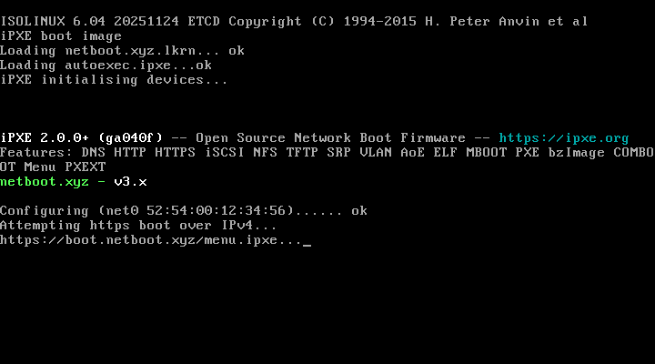

# Network install with netboot.xyz

**netboot.xyz** is a tiny boot program (iPXE) with a menu of operating-system installers
and tools. Each one is downloaded from the internet only when you pick it, so a few
megabytes on the stick give you dozens of systems.

## Requirements

- **Wired Ethernet with DHCP.** iPXE has no Wi-Fi. USB-Ethernet adapters work on many PCs
  but not all — if yours isn't detected, use the [home base install](05-install-an-os.md),
  which works over Wi-Fi.
- Outbound HTTPS (port 443) to `boot.netboot.xyz` and the distribution mirrors.

## Steps

1. Boot the stick and choose **Network install (netboot.xyz)** in the Ventoy menu.
2. iPXE gets an address and loads the live menu from `boot.netboot.xyz` (5–30 s).
3. Move off **Boot from local hdd** (the highlighted default, which runs after a countdown)
   and choose **Linux Network Installs (64-bit)** → a distribution → a version → the installer type.
4. The distribution's normal installer starts, downloading packages as it goes.

| Menu | What's in it |
|---|---|
| Linux Network Installs (64-bit) | Debian, Ubuntu, Fedora, Rocky/Alma, openSUSE, Arch, Alpine, … |
| Live CDs | full live desktops streamed over the network |
| BSD Installs / Unix Network Installs | FreeBSD, OpenBSD, illumos, … |
| FreeDOS | DOS for firmware updaters |
| Windows | needs your own WinPE server — not set up by one-os |
| Utilities (64-bit) | memory test, disk wiping, partition tools, rescue systems |
| iPXE shell, Network card info, PCI Device List | diagnostics |

The menu is downloaded from netboot.xyz each time, so it can change; it isn't stored on the stick.

## UEFI and BIOS

The stick carries two builds and shows the right one automatically: `netboot.xyz.efi` in
UEFI mode and `netboot.xyz.iso` in legacy BIOS mode (the ISO's UEFI loader can't be started
by Ventoy — details in the [spike report](../spike.md)). Both are pinned by checksum in
`manifest.yaml`.

## Troubleshooting

| Symptom | Fix |
|---|---|
| `No configuration methods succeeded` / DHCP timeout | No wired link or no DHCP. Check the cable; try another port or adapter. |
| `Could not boot: Error 0x...` then *Booting from local disks* | The menu's countdown ran out and it tried the PC's own disk — reboot and pick an entry sooner. |
| HTTPS / certificate errors | The PC clock is far off; set it in firmware setup. |
| Corporate network blocks it | Use the home base install or an offline ISO instead. |
