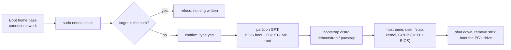

# Install an OS onto another drive

`oneos-install` installs **Debian**, **Ubuntu** or **Arch Linux** from the home base onto a
drive in the PC. Unlike netboot.xyz it works over **Wi-Fi**, because the home base handles
the network.



## Before you start

- **Back up the target drive. It is erased completely.**
- Know which drive is the target: run `lsblk -o NAME,SIZE,MODEL,TRAN` and match the size/model.
  NVMe drives are `/dev/nvme0n1`, SATA drives `/dev/sda`, …; the stick itself shows `TRAN usb`.
- Connect to the internet (packages are downloaded during the install).

## Interactive install

```bash
sudo oneos-install
```

It lists the drives, then asks:

| Question | Example | Default |
|---|---|---|
| Target disk | `/dev/nvme0n1` | — |
| Distro | `debian`, `ubuntu`, `arch` | `debian` |
| Hostname | `workbench` | `oneos-<distro>` |
| User name | `alex` | `oneos` |
| Confirmation | type `yes` | — |
| Password for the user | (asked during the install) | — |

Then: shut down, remove the stick, and boot the PC normally.

## One-line install

```bash
sudo oneos-install --target /dev/nvme0n1 --distro debian --hostname workbench --user alex
```

| Option | Meaning |
|---|---|
| `--target DISK` | whole disk to erase and install onto |
| `--distro debian\|ubuntu\|arch` | what to install |
| `--suite NAME` | release: Debian `trixie` (default), Ubuntu `noble` (default) or newer |
| `--hostname NAME`, `--user NAME` | system name and first user (gets `sudo`) |
| `--password-hash HASH` | set the user's password non-interactively (`openssl passwd -6`) |
| `--mirror URL` | package mirror (or set `ONEOS_MIRROR`) |
| `--efi` / `--bios` | install only one boot loader; default installs **both** so the disk boots either way |
| `--unattended` | no prompts (for automation; the user's password is locked unless `--password-hash`) |

## What you get

- GPT disk: 1 MB BIOS-boot partition, 512 MB EFI system partition, ext4 root.
- Kernel, GRUB for UEFI (removable path, so no NVRAM entry is needed) **and** legacy BIOS.
- A minimal system: console login, `sudo`, SSH client, DHCP on the first wired interface.
  Add a desktop afterwards, e.g. `sudo apt install task-xfce-desktop` (Debian),
  `sudo apt install ubuntu-desktop-minimal` (Ubuntu), `sudo pacman -S plasma` (Arch).

### Wi-Fi-only PCs: add networking before you reboot

The minimal system has no Wi-Fi tools. While still in the home base, after `oneos-install`
finishes (Debian/Ubuntu shown; replace `/dev/nvme0n1p3` with the root partition it created):

```bash
sudo mount /dev/nvme0n1p3 /mnt
for d in dev proc sys run; do sudo mount --bind /$d /mnt/$d; done
sudo cp /etc/resolv.conf /mnt/etc/resolv.conf
sudo chroot /mnt apt-get install -y network-manager firmware-iwlwifi   # Debian; Ubuntu: linux-firmware
for d in run sys proc dev; do sudo umount /mnt/$d; done; sudo umount /mnt
```

On Arch: `sudo arch-chroot /mnt pacman -S networkmanager` and enable it with
`systemctl enable NetworkManager` inside the chroot.

## Safety rules built in

- It **refuses the drive the home base booted from** (it follows the stick through Ventoy's
  device-mapper layer), and refuses drives with mounted partitions.
- Interactive mode shows the drive's model and serial and requires typing `yes`.
- Checksums: the Arch bootstrap tarball is verified against the mirror's `sha256sums.txt`;
  Debian/Ubuntu packages are verified by apt's signed repositories.

These guarantees are tested on every change (tests T50 and T51 — [testing](../developer-guide/02-testing.md)).
