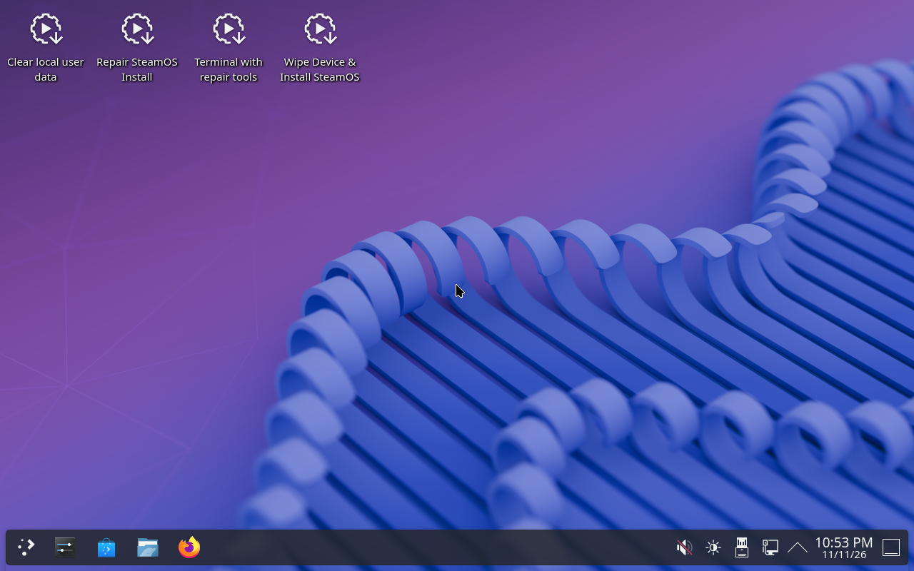

# Install SteamOS

The stick carries **Valve's own SteamOS recovery stick** in a reserved area behind Ventoy.
Booting it gives you Valve's recovery desktop, and you install SteamOS exactly as Valve
documents it for the Steam Deck.



## Before you start

- **AMD graphics** (Radeon RX 6000–9000 or a Ryzen with Radeon graphics). SteamOS has no
  NVIDIA support.
- **The target is an M.2 NVMe drive** and is the PC's first NVMe drive (`nvme0n1`). Valve's
  installer always writes that drive, and **erases all of it**. Unplug other NVMe drives
  you care about.
- In the firmware setup: **UEFI on, Secure Boot off**.

## Steps

1. Boot the PC from the stick (boot-menu key, see [Booting on a PC](02-booting.md)).
2. In the Ventoy menu press **F6**, choose **SteamOS recovery - Valve's installer**.
3. Wait for the purple desktop (a minute or two).
4. Double-click **Wipe Device & Install SteamOS**, confirm, wait for it to finish
   (5–15 min), then reboot and remove the stick.

The other icons are Valve's too: **Repair SteamOS Install** (keeps games and user data),
**Clear local user data**, **Terminal with repair tools**.

## Troubleshooting

### Setup says *No networks found* and never continues (Ethernet plugged in)

**Cause (SteamOS bug, [ValveSoftware/SteamOS#2514](https://github.com/ValveSoftware/SteamOS/issues/2514)):**
when first-time setup starts, Steam asks SteamOS to switch its Wi-Fi backend.
`steamos-wifi-set-backend-privileged` stops NetworkManager, tries
`iw phy phy0 interface add wlan0`, fails because the PC has no Wi-Fi *that SteamOS can
drive*, and exits (`set -e`) before it restarts NetworkManager. Wired networking goes
down with it: the link is up, DHCP starts, then is cancelled. It hits PCs with no Wi-Fi
and PCs whose Wi-Fi has no driver in SteamOS's kernel (e.g. the MediaTek MT7927 on
X870E boards; SteamOS 3.8 runs kernel 6.16, the driver arrived in 7.2). Valve has merged
a fix; it reaches you once a new recovery image ships.

The "Choose your network" list only ever shows Wi-Fi — wired never appears in it; setup
moves on by itself once NetworkManager stays up.

**Fix without a USB Wi-Fi adapter**: add a guard that restarts NetworkManager, to the
installed system's `/etc` overlay, from a rescue system (the home base or Valve's
recovery desktop) *before* the first boot of the install:

```bash
# from the rescue system, as root; the install's var partitions are var-A / var-B
for p in /dev/disk/by-partlabel/var-A /dev/disk/by-partlabel/var-B; do
  mount "$p" /mnt
  U=/mnt/lib/overlays/etc/upper/systemd/system
  install -d -m 755 "$U/multi-user.target.wants"
  cat >"$U/oneos-nm-guard.service" <<'EOF'
[Unit]
Description=Restart NetworkManager if it is left stopped (SteamOS#2514)
After=NetworkManager.service
Conflicts=shutdown.target
Before=shutdown.target

[Service]
ExecStart=/bin/sh -c 'while sleep 5; do case "$(systemctl is-system-running)" in stopping) exit 0;; esac; systemctl is-active -q NetworkManager || { echo "NetworkManager was stopped; starting it"; systemctl start NetworkManager; }; done'
Restart=always

[Install]
WantedBy=multi-user.target
EOF
  ln -sf /etc/systemd/system/oneos-nm-guard.service "$U/multi-user.target.wants/"
  umount /mnt
done
```

On first boot the journal shows `NetworkManager was stopped; starting it` once and setup
continues over Ethernet. Remove the two files when Wi-Fi works. Changing
`wifi.backend` in `99-valve-wifi-backend.conf` does **not** help: Steam rewrites it on
every boot. Other workarounds from the issue: a supported USB Wi-Fi adapter for the
first boot, or Desktop Mode from the power menu and signing in to Steam there.

### Wi-Fi missing after install (new boards)

Check the driver: `lspci -k` (in Desktop Mode → Konsole). `MEDIATEK … 7927` with no
`Kernel driver in use` means SteamOS's kernel is too old for the chip. Use Ethernet,
then **Settings → System → Update Channel → Beta** (3.9.x, kernel 7.2) and update.
Don't build a DKMS driver on SteamOS: the root is read-only and every update replaces it.

### The update fails: *Destination device '/dev/disk/by-partsets/B/rootfs' … not found*

You ran it on the **recovery stick**, which has one system slot (A); updates write the
other slot (B) of an installed system. Check where you are with `findmnt -no SOURCE /`:
`/dev/nvme0n1p4`/`p5` is the installed system, `/dev/sdX3` is the stick. If the PC keeps
booting the stick, remove it (`efibootmgr` → `BootCurrent` names the entry used).

## Without a stick: over the network

PCs on the LAN can install SteamOS from the [network boot server](../operator-guide/05-network-boot-server.md):
*Install SteamOS onto this PC's M.2 drive* in its menu runs one-os's installer, which uses
the same Valve image and installer.

## How it's built

`manifest.yaml` → `steamos.recovery_on_stick: true` and `ventoy.options.reserve_mb: 8192`.
While flashing, `scripts/stick-add-steamos.sh` copies the five partitions of Valve's recovery
image (`make steamos-fetch`) after Ventoy's, keeping Valve's partition IDs, and writes the F6
entry (`ventoy/ventoy_grub.cfg`). Test: T120 boots the entry to this desktop.
